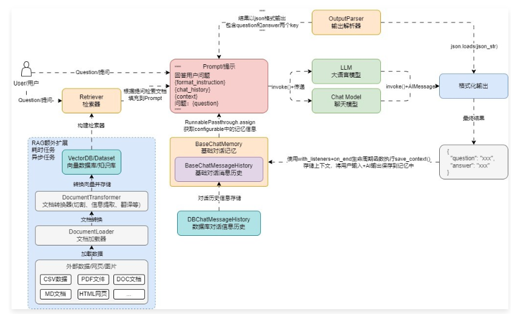
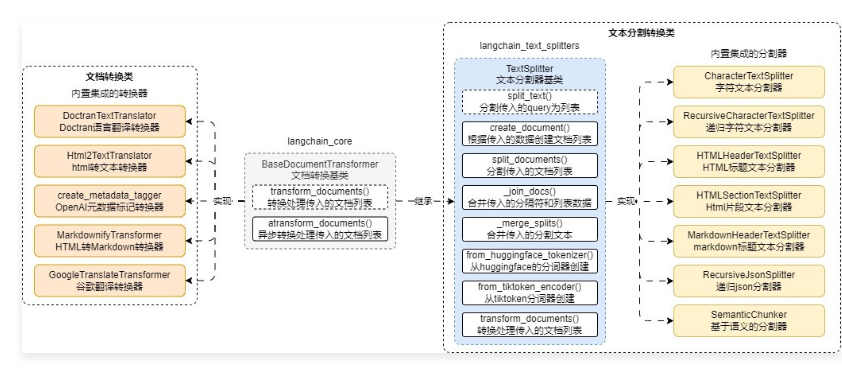

## 2\-6 文档转换器与字符分割器组件的使用

__01\. DocumentTransformer 组件__

在 LangChain 中，使用 文档加载器 加载得到的文档一般来说存在着几个问题：__原始文档太大、原始文档的数据格式不符合需求（需要英文但是只有中文）、原始文档的信息没有经过提炼__等问题。

如果将这类数据直接转换成向量并存储到数据库中，会导致在执行相似性搜索和 RAG 的过程中，错误率大大提升。所以在 LLM 应用开发中，在加载完数据后，一般会执行多一步 转换 的过程，即将加载得到的 文档列表 进行转换，得到符合需求的文档列表。

转换涵盖的操作就非常多，例如：__文档切割、文档属性提取、文档翻译、HTML 转文本、重排、元数据标记__等都属于转换。

在前面的聊天机器人架构中添加上转换步骤，更新后的 聊天机器人架构/运行流程 如下所示



在 LangChain 中针对文档的转换也统一封装了一个基类 BaseDocumentTransformer，__所有涉及到文档的转换的类均是该类的子类__，将大块文档切割成 chunk 分块的文档分割器也是 BaseDocumentTransformer 的子类实现。

BaseDocumentTransformer 基类封装了两个方法：

1. transform\_documents\(\)：抽象方法，传递文档列表，返回转换后的文档列表。
2. atransform\_documents\(\)：转换文档列表函数的异步实现，如果没有实现，则会委托 transform\_documents\(\) 函数实现。

在 LangChain 中，文档转换组件分成了两类：文档分割器\(使用频率高\)、文档处理转换器\(使用频率低，老版本写法\)。

并且目前 LangChain 团队已经将 文档分割器 这个高频使用的部分单独拆分成一个 Python 包，哪怕不使用 LangChain 框架本身进行开发，也可以使用其文本分割包，快速分割数据，在使用前必须执行以下命令安装：

pip install \-qU langchain\-text\-splitters

对于文本分割器来说，除了继承 BaseDocumentTransformer，还单独设置了文本分割器基类 TextSplitter，从而去实现更加丰富的功能，BaseDocumentTransformer 衍生出来的类图



__02\. 字符分割器基础使用技巧__

在文档分割器中，最简单的分割器就是——__字符串分割器__，这个组件会基于给定的字符串进行分割，默认为 \\n\\n，并且在分割时会尽可能保证数据的连续性。分割出来每一块的长度是通过字符数来衡量的，使用起来也非常简单，实例化 CharacterTextSplitter 需传递多个参数，信息如下：

1. separator：分隔符，默认为 \\n\\n。
2. is\_separator\_regex：是否正则表达式，默认为 False。
3. chunk\_size：每块文档的内容大小，默认为 4000。
4. chunk\_overlap：块与块之间重叠的内容大小，默认为 200。
5. length\_function：计算文本长度的函数，默认为 len。
6. keep\_separator：是否将分隔符保留到分割的块中，默认为 False。
7. add\_start\_index：是否添加开始索引，默认为 False，如果是的话会在元数据中添加该切块的起点。
8. strip\_whitespace：是否删除文档头尾的空白，默认为 True。

如果想将文档切割为不超过 500 字符，并且每块之间文本重叠 50 个字符，可以使用 CharacterTextSplitter 来实现，代码如下

```python
from langchain_community.document_loaders import UnstructuredMarkdownLoader
from langchain_text_splitters import CharacterTextSplitter

# 1.构建Markdown文档加载器并获取文档列表
loader = UnstructuredMarkdownLoader("./项目API文档.md")
documents = loader.load()

# 2.构建分割器
text_splitter = CharacterTextSplitter\(
separator="\\n\\n",
chunk_size=500,
chunk_overlap=50,
add_start_index=True,
)

# 3.分割文档列表
chunks = text_splitter.split_documents(documents)

# 4\.输出信息
for chunk in chunks:
print(f"块内容大小:{len(chunk.page_content)},元数据:{chunk.metadata}")
```

输出内容

Created a chunk of size 771, which is longer than the specified 500

Created a chunk of size 980, which is longer than the specified 500

Created a chunk of size 542, which is longer than the specified 500

Created a chunk of size 835, which is longer than the specified 500

块内容大小:251,元数据:\{'source': '\./项目API文档\.md', 'start\_index': 0\}

块内容大小:451,元数据:\{'source': '\./项目API文档\.md', 'start\_index': 246\}

块内容大小:771,元数据:\{'source': '\./项目API文档\.md', 'start\_index': 699\}

块内容大小:435,元数据:\{'source': '\./项目API文档\.md', 'start\_index': 1472\}

块内容大小:497,元数据:\{'source': '\./项目API文档\.md', 'start\_index': 1859\}

块内容大小:237,元数据:\{'source': '\./项目API文档\.md', 'start\_index': 2359\}

块内容大小:980,元数据:\{'source': '\./项目API文档\.md', 'start\_index': 2598\}

块内容大小:438,元数据:\{'source': '\./项目API文档\.md', 'start\_index': 3580\}

块内容大小:293,元数据:\{'source': '\./项目API文档\.md', 'start\_index': 4013\}

块内容大小:498,元数据:\{'source': '\./项目API文档\.md', 'start\_index': 4261\}

块内容大小:463,元数据:\{'source': '\./项目API文档\.md', 'start\_index': 4712\}

块内容大小:438,元数据:\{'source': '\./项目API文档\.md', 'start\_index': 5129\}

块内容大小:542,元数据:\{'source': '\./项目API文档\.md', 'start\_index': 5569\}

块内容大小:464,元数据:\{'source': '\./项目API文档\.md', 'start\_index': 6113\}

块内容大小:835,元数据:\{'source': '\./项目API文档\.md', 'start\_index': 6579\}

块内容大小:489,元数据:\{'source': '\./项目API文档\.md', 'start\_index': 7416\}

使用 CharacterTextSplitter 进行分割时，虽然传递了 chunk\_size 为 500，但是仍然没法确保分割出来的文档一直保持在这个范围内，这是因为在底层 CharacterTextSplitter 是先按照分割符号拆分整个文档，然后循环遍历拆分得到的列表，将每个列表逐个相加，直到最接近 chunk\_size 窗口大小时则完成一个 Document 的组装。

但是如果基于分割符号得到的文本，本身长度已经超过了 chunk\_size，则会直接进行警告，并且将对应的文本单独变成一个块。

核心代码如下

```python
\# langchain\_text\_splitters/character\->CharacterTextSplitter::split\_text

def split_text(self, text: str) -> List[str]:
    separator = self._separator
    splits = _split_text_with_regex(
        text, separator, self._keep_separator, self._is_separator_regex
    )
    _separator = "" if self._keep_separator else self._separator
    return self._merge_splits(splits, _separator)

def _split_text_with_regex(
    text: str, separator: str, keep_separator: bool, is_regex: bool = False
) -> List[str]:
    if not separator:
        return list(text)

    if is_regex:
        # 正则模式，直接使用 re.split
        if keep_separator:
            _splits = re.split(f"({separator})", text)
            splits = [_splits[i] + _splits[i + 1] for i in range(1, len(_splits), 2)]
            if len(_splits) % 2 == 0:
                splits += _splits[-1:]
            splits = [_splits[0]] + splits
        else:
            splits = re.split(separator, text)
    else:
        # 普通字符串分隔，避免 re.escape 引入多余转义
        if keep_separator:
            parts = text.split(separator)
            splits = []
            for i, part in enumerate(parts):
                if i > 0:
                    splits.append(separator)
                splits.append(part)
        else:
            splits = text.split(separator)

    return [s for s in splits if s != ""]
```