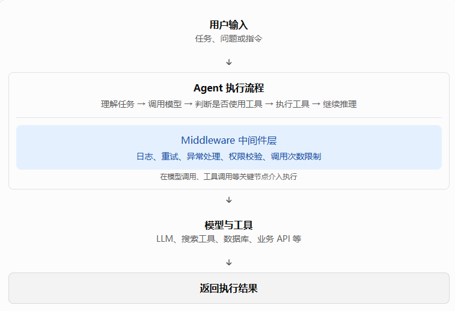

# LangChain Agent 中间件（Middleware）详解

> 适用范围：LangChain Python Agent Middleware 体系。本文围绕
> `create_agent(..., middleware=[...])`
> 展开，包含设计思想、常见内置中间件、关键参数、代码示例和选型建议。
>
> **版本提醒：** LangChain 的中间件 API
> 会随版本演进。本文中的类名、导入路径、参数和钩子签名应在实际项目中以当前安装版本的官方文档为准。运行
> Demo 前，请先核对版本兼容性。

## 目录

1.  [什么是中间件](#一什么是中间件)
2.  [接入方式与基本概念](#二接入方式与基本概念)
3.  [常见内置中间件](#三常见内置中间件)
4.  [自定义中间件](#四自定义中间件)
5.  [中间件选型表](#五中间件选型表)
6.  [组合使用示例](#六组合使用示例)
7.  [学习路线与总结](#七学习路线与总结)
8.  [官方文档](#八官方文档)

------------------------------------------------------------------------

## 一、什么是中间件

### 1.1 为什么需要中间件？

一个简单的 Agent 可以这样创建：

``` python
from langchain.agents import create_agent

agent = create_agent(
    model=model,
    tools=[search_tool, database_tool],
)

result = agent.invoke({
    "messages": [
        {"role": "user", "content": "帮我查询订单"}
    ]
})
```

随着业务复杂度增加，往往还需要处理：

-   模型 API 超时或限流时自动重试；
-   限制模型调用和工具调用次数，避免成本失控；
-   对话过长时压缩上下文；
-   检测或脱敏邮箱等个人信息；
-   调用退款、删除数据等高风险工具前请求人工审批；
-   统一记录模型调用和工具执行日志；
-   对工具异常进行统一处理。

如果把这些逻辑分别塞进每个工具或业务节点，代码会越来越难维护。

**中间件的核心价值：将日志、重试、限流、安全检查、上下文管理等横切关注点从主要业务逻辑中抽离出来，在
Agent 执行流程的特定位置统一处理。**

LangChain 的 Middleware（中间件）和 Java 的 AOP（面向切面编程）有很强的相似性：都是把公共的、与核心业务无关的逻辑抽离出来，减少代码冗余

### 1.2 中间件在 Agent 架构中的位置

从架构层面看，中间件位于 Agent 的执行流程中，负责在关键执行节点进行拦截、处理和控制。 它不负责定义 Agent 的核心业务目标，而是为 Agent 提供日志记录、异常处理、重试、权限校验等通用能力。

可以把 Agent 理解为一个负责完成任务的执行系统，而中间件则负责管理执行过程中的通用逻辑。



注意：图中把中间件单独画成一层，是为了便于理解。它并不是一个独立于 Agent 执行流程之外的服务，而是通过钩子或包装机制，介入执行流程中的特定阶段。

### 1.3 中间件的主要特点

LangChain Agent 中间件的核心特点是：在不大幅修改 Agent 核心业务逻辑的前提下，对执行流程进行扩展、干预和控制。

可以从以下几个方面理解。

#### 1.3.1 横切关注点分离

中间件将日志记录、异常处理、重试、权限校验等通用逻辑，从 Agent 的核心任务逻辑中抽离出来。

例如，Agent 原本只需要调用搜索工具获取信息，不必在搜索业务代码中反复编写日志记录和异常处理逻辑，可以交由对应的中间件统一处理。

这样能够减少代码重复，降低不同业务逻辑之间的耦合。

#### 1.3.2 在关键执行节点介入

中间件并不是简单地在 Agent 执行前后各运行一次，而是可以根据不同的钩子，在执行流程的特定阶段介入。

例如：

- `before_model`：模型调用前执行检查或准备工作。
- `wrap_model_call`：包装模型调用，可以在调用前后执行逻辑，也可以控制调用方式。
- `wrap_tool_call`：包装工具调用，可以统一处理工具调用过程及其异常。
- `after_model`：模型调用后执行处理逻辑。

不同钩子的执行时机和控制能力不同，应根据具体需求选择。

#### 1.3.3 具备执行控制能力

中间件不仅能够观察和记录 Agent 的执行过程，还可以在一定范围内影响执行行为。

例如：

- 模型调用失败时，决定是否重试。
- 检查工具调用是否符合权限要求。
- 限制模型或工具的调用次数。
- 根据当前状态调整传递给模型的上下文。
- 在满足特定条件时提前结束执行或返回结果。

因此，中间件不只是一个日志工具，也可以成为 Agent 执行流程的控制机制。

#### 1.3.4 具备可组合性

一个 Agent 可以配置多个中间件，让不同中间件分别负责不同的职责。

例如：

```python
agent = create_agent(
    model=model,
    tools=tools,
    middleware=[
        logging_middleware,       # 日志记录
        retry_middleware,         # 失败重试
        human_approval_middleware # 人工审批
    ]
)
```

以上代码仅用于展示组合方式，具体变量和参数取决于所使用的中间件实现。

通过组合不同中间件，可以逐步增强 Agent 的能力，而不必把所有逻辑都塞进一个庞大的执行函数中。需要注意的是，多个中间件的执行顺序、嵌套关系及相互影响，仍然需要明确设计。

#### 1.3.5 关注执行过程，而非业务目标

中间件主要关注 Agent 如何执行任务，而不是直接定义 Agent 应该完成什么任务。

| 对比维度 | Agent 核心逻辑               | 中间件                                 |
| -------- | ---------------------------- | -------------------------------------- |
| 主要职责 | 完成业务目标                 | 管理和扩展执行过程                     |
| 关注重点 | 任务规划、模型推理、工具选择 | 日志、重试、安全检查、调用控制         |
| 典型问题 | 应该调用哪个工具？           | 调用工具前是否需要权限校验？           |
| 修改目的 | 改变任务处理方式             | 增强执行过程的可靠性、安全性和可维护性 |

两者的边界并非绝对：中间件也可能修改上下文或影响决策，但它通常不应该取代 Agent 的核心业务职责。

## 二、接入方式与基本概念

### 2.1 通过 `middleware` 注册

``` python
from langchain.agents import create_agent
from langchain.agents.middleware import (
    ModelCallLimitMiddleware,
    ToolRetryMiddleware,
)

agent = create_agent(
    model=model,
    tools=[search_tool],
    middleware=[
        ModelCallLimitMiddleware(
            run_limit=5,
            exit_behavior="end",
        ),
        ToolRetryMiddleware(
            max_retries=3,
        ),
    ],
)
```

常见参数：

----------------- --------------------------------------
  `model`           Agent 使用的聊天模型
  `tools`           Agent 可调用的工具
  `middleware`      中间件实例或符合接口的中间件列表
  `system_prompt`   系统提示词
  `checkpointer`    持久化线程状态，用于跨调用恢复等场景

中间件通常由框架在执行到对应阶段时自动调用，不需要开发者手动调用每一个中间件。

### 2.2 Checkpointer 与线程状态

某些中间件支持线程级限制、暂停后恢复等能力。这些功能通常依赖持久化状态和稳定的
`thread_id`。

``` python
from langgraph.checkpoint.memory import InMemorySaver
from langchain.agents import create_agent

agent = create_agent(
    model=model,
    tools=tools,
    checkpointer=InMemorySaver(),
)

result = agent.invoke(
    {"messages": [{"role": "user", "content": "帮我分析数据"}]},
    config={"configurable": {"thread_id": "user-001"}},
)
```

`InMemorySaver`
适合本地演示和测试。生产环境应根据可靠性、部署架构和恢复要求选择合适的持久化
checkpointer。

------------------------------------------------------------------------

## 三、常见内置中间件

> 下列示例用于说明典型用法。具体类名、参数类型、默认值、错误策略和导入路径可能随
> LangChain 版本变化；请在运行前核对官方文档及当前安装版本。

### 3.1 `ModelCallLimitMiddleware`：限制模型调用次数

**用途：** 防止 Agent 反复调用模型，导致成本增加或执行失控。

``` python
from langchain.agents.middleware import ModelCallLimitMiddleware

middleware = ModelCallLimitMiddleware(
    run_limit=5,
    thread_limit=10,
    exit_behavior="end",
)
```

关键参数：

  `run_limit`                         单次 Agent 执行允许的最大模型调用次数

  `thread_limit`                      同一线程跨多次执行累计允许的最大模型调用次数

  `exit_behavior`                     达到限制后的处理方式；常见选项为 `"end"` 或 `"error"

示例：

``` python
from langchain.agents import create_agent
from langgraph.checkpoint.memory import InMemorySaver
from langchain.agents.middleware import ModelCallLimitMiddleware

agent = create_agent(
    model=model,
    tools=tools,
    checkpointer=InMemorySaver(),
    middleware=[
        ModelCallLimitMiddleware(
            run_limit=5,
            thread_limit=10,
            exit_behavior="end",
        )
    ],
)
```

注意：模型调用次数不等于工具调用次数。一个 Agent
在调用工具前后可能多次请求模型。

### 3.2 `ToolCallLimitMiddleware`：限制工具调用次数

**用途：** 防止工具调用过于频繁或陷入重复调用循环。

``` python
from langchain.agents.middleware import ToolCallLimitMiddleware

middleware = ToolCallLimitMiddleware(
    run_limit=5,
    thread_limit=20,
    exit_behavior="error",
)
```

关键参数：

-   `run_limit`：单次执行允许的工具调用数量上限。
-   `thread_limit`：同一线程跨多次执行的工具调用数量上限。
-   `exit_behavior`：达到限制后的处理方式。

适用场景包括限制搜索次数、数据库查询次数或外部 API 调用次数。

注意：限制调用次数不等于限制实际成本。每次工具调用仍应有自己的超时、权限和业务限额。

### 3.3 `ModelRetryMiddleware`：模型调用失败重试

**用途：** 处理模型服务偶发超时、临时网络错误或限流。

``` python
from langchain.agents.middleware import ModelRetryMiddleware

middleware = ModelRetryMiddleware(
    max_retries=3,
    backoff_factor=2.0,
    initial_delay=1.0,
    max_delay=30.0,
    jitter=True,
)
```

关键参数：

  `max_retries`      最大重试次数；是否包含首次调用以具体版本定义为准
  `initial_delay`    首次重试的基础等待时间，通常以秒为单位
  `backoff_factor`   指数退避增长系数
  `max_delay`        单次等待时间上限
  `jitter`           加入随机扰动，降低大量请求同时重试的风险

例如，基础等待时间为 1 秒、增长系数为 2 时，等待时间可能逐渐变为 1、2、4
秒，并受到最大延迟和随机扰动等配置影响。

不要重试所有错误。参数校验失败、权限错误等确定性错误通常应直接返回。

### 3.4 `ToolRetryMiddleware`：工具调用失败重试

**用途：** 处理工具执行时的临时失败。

``` python
from langchain.agents.middleware import ToolRetryMiddleware

middleware = ToolRetryMiddleware(
    max_retries=3,
    backoff_factor=2.0,
    initial_delay=1.0,
    max_delay=30.0,
    jitter=True,
    tools=["search_api"],
    retry_on=(ConnectionError, TimeoutError),
)
```

关键参数：

-   `max_retries`：最大重试次数。
-   `tools`：指定需要使用重试策略的工具。
-   `retry_on`：指定触发重试的异常类型。
-   `initial_delay`、`backoff_factor`、`max_delay`、`jitter`：控制退避策略。
-   `on_failure`：部分版本提供该选项，用于控制重试失败后的行为；以当前版本文档为准。

示例中只重试
`search_api`，避免对所有工具一视同仁。对于支付、退款、写数据库等有副作用的操作，必须考虑幂等性，防止重试造成重复执行。

### 3.5 `ModelFallbackMiddleware`：模型降级

**用途：** 主模型不可用时，尝试备用模型。

``` python
from langchain.agents.middleware import ModelFallbackMiddleware

middleware = ModelFallbackMiddleware(
    models=[backup_model_1, backup_model_2],
)
```

注册方式：

``` python
from langchain.agents import create_agent
from langchain.agents.middleware import ModelFallbackMiddleware

agent = create_agent(
    model=primary_model,
    tools=tools,
    middleware=[
        ModelFallbackMiddleware(
            models=[backup_model_1, backup_model_2],
        )
    ],
)
```

关键参数：

-   `models`：备用模型列表，通常按配置顺序尝试。
-   `model`：主模型，通过 `create_agent` 的 `model` 参数指定。

注意：备用模型需要尽可能兼容 Agent
所需的工具协议、上下文窗口和结构化输出能力。降级成功不一定意味着业务结果与主模型完全等价。

### 3.6 `SummarizationMiddleware`：对话自动摘要

**用途：** 对话历史变长时压缩上下文。

``` python
from langchain.agents.middleware import SummarizationMiddleware

middleware = SummarizationMiddleware(
    model=summary_model,
    trigger=("tokens", 4000),
    keep=("messages", 20),
)
```

 关键参数：

  `model`     用于生成摘要的模型
  `trigger`   触发摘要的阈值
  `keep`      摘要后希望保留的近期消息范围

常见阈值示意：

``` python
trigger=("tokens", 3000)
trigger=("messages", 50)
trigger=("fraction", 0.8)
```

某些版本允许传入多个触发条件：

``` python
trigger=[
    ("tokens", 3000),
    ("messages", 50),
]
```

多个条件通常用于在任一阈值满足时触发，但请核对当前版本的具体语义。

**重要理解：摘要不是永久记忆，而是对当前上下文的压缩。**
如果关键细节没有进入摘要，就可能丢失。订单号、任务 ID
等关键业务数据应单独持久化，而不应只依赖对话摘要。

### 3.7 `PIIMiddleware`：个人敏感信息检测与处理

**用途：** 检测、遮蔽或阻止邮箱、信用卡号等个人身份信息（PII）。

``` python
from langchain.agents.middleware import PIIMiddleware

middleware = PIIMiddleware(
    "email",
    strategy="redact",
    apply_to_input=True,
    apply_to_output=False,
)
```

关键参数：

  `pii_type`                          要检测的信息类型，例如 `email`、`credit_card`、`ip`、`mac_address`、`url`

  `strategy`                          检测后的处理策略

  `apply_to_input`                    是否处理输入方向的信息

 `apply_to_output`                   是否处理输出方向的信息


常见策略包括：

-   `block`：检测到目标信息时阻止处理。
-   `redact`：替换为类似 `[REDACTED_EMAIL]` 的占位符。
-   `mask`：部分遮蔽信息。
-   `hash`：转换为确定性哈希形式，适合某些需要关联记录的场景。

例如：

``` text
原始输入：请联系 zhang@example.com
脱敏后：请联系 [REDACTED_EMAIL]
```

PII
检测不能保证发现所有敏感信息，也不能替代工具权限、传输加密、日志脱敏和数据保留策略。

### 3.8 `HumanInTheLoopMiddleware`：人工审批

**用途：**
在退款、转账、删除数据等高风险工具执行前暂停流程，等待人工决策。

``` python
from langchain.agents.middleware import HumanInTheLoopMiddleware
from langgraph.checkpoint.memory import InMemorySaver

middleware = HumanInTheLoopMiddleware(
    interrupt_on={
        "refund": {
            "allowed_decisions": ["approve", "reject", "edit"]
        }
    }
)
```

完整注册示例：

``` python
from langchain.agents import create_agent
from langchain.agents.middleware import HumanInTheLoopMiddleware
from langgraph.checkpoint.memory import InMemorySaver

agent = create_agent(
    model=model,
    tools=[search_tool, refund_tool],
    checkpointer=InMemorySaver(),
    middleware=[
        HumanInTheLoopMiddleware(
            interrupt_on={
                "refund": {
                    "allowed_decisions": [
                        "approve",
                        "reject",
                        "edit",
                    ]
                }
            }
        )
    ],
)
```

关键概念：

-   `interrupt_on`：配置哪些工具需要人工介入。
-   `allowed_decisions`：允许的人工决策，例如批准、拒绝或修改参数后批准。
-   `checkpointer`：保存中断时的状态，以便后续恢复。

典型流程：

1.  模型提出调用 `refund` 工具。
2.  中间件暂停执行。
3.  人工检查工具名称、参数和业务风险。
4.  人工批准、拒绝或修改参数。
5.  Agent 根据决策继续执行。

生产环境应使用可靠的持久化
checkpointer，并在工具层强制执行授权；不能仅依赖模型提示词判断权限。

### 3.9 `LLMToolSelectorMiddleware`：工具筛选

**用途：** 工具数量较多时，筛选与当前任务相关的工具。

``` python
from langchain.agents.middleware import LLMToolSelectorMiddleware

middleware = LLMToolSelectorMiddleware(
    model=selector_model,
    max_tools=3,
    always_include=["search"],
)
```

关键参数：

-   `model`：负责筛选工具的模型。
-   `max_tools`：每次最多保留的工具数量。
-   `always_include`：无论筛选结果如何都保留的工具名称。

例如，系统有 30
个工具，用户询问天气时，可以优先保留天气相关工具，而不是把全部工具都交给主模型。

权衡：筛选器本身也会消耗模型调用成本；若错误排除了必需工具，Agent
可能无法完成任务。应通过实际任务集评估筛选效果。

### 3.10 `TodoListMiddleware`：任务清单

**用途：** 帮助 Agent 拆分多步骤任务并跟踪进度。

``` python
from langchain.agents.middleware import TodoListMiddleware

agent = create_agent(
    model=model,
    tools=tools,
    middleware=[TodoListMiddleware()],
)
```

它会为 Agent 提供 `write_todos` 工具，帮助创建和更新任务清单。

适用场景：

-   分析多个文件并生成报告；
-   先收集数据，再分析，最后输出结论；
-   多步骤研究任务；
-   需要展示执行进度的 Agent。

任务清单不保证每个步骤都正确执行，也不等于严格的工作流调度系统。存在事务要求或强依赖关系时，仍需明确的业务约束。

### 3.11 `ToolErrorMiddleware`：工具异常处理

**用途：** 统一决定工具异常如何呈现或传递给 Agent。

``` python
from langchain.agents.middleware import ToolErrorMiddleware

agent = create_agent(
    model=model,
    tools=tools,
    middleware=[ToolErrorMiddleware()],
)
```

它可用于处理选定的工具异常，并将适当的错误信息返回给模型，让 Agent
决定是否修正参数、换工具或向用户说明情况。可配置的异常类型、回调和错误策略取决于当前版本。

与 `ToolRetryMiddleware` 的区别：

-   `ToolRetryMiddleware`：重点在于失败后重试。
-   `ToolErrorMiddleware`：重点在于异常如何传递和呈现。

不要无限重试，也不要把内部数据库错误、密钥或完整堆栈原样泄露给模型和最终用户。

### 3.12 `ContextEditingMiddleware`：编辑上下文

**用途：** 清理较早的工具结果，避免工具返回的大量内容持续占用上下文。

``` python
from langchain.agents.middleware import (
    ContextEditingMiddleware,
    ClearToolUsesEdit,
)

middleware = ContextEditingMiddleware(
    edits=[
        ClearToolUsesEdit(
            trigger=10000,
            keep=3,
        )
    ]
)
```

关键概念：

-   `edits`：上下文编辑策略列表。
-   `ClearToolUsesEdit`：清理较早的工具调用结果。
-   `trigger`：触发清理的 Token 阈值。
-   `keep`：保留最近多少条工具结果。

### 3.13 `LLMToolEmulator`：模拟工具执行

**用途：** 测试 Agent 时，不真实调用外部系统。

``` python
from langchain.agents.middleware import LLMToolEmulator

middleware = LLMToolEmulator(
    tools=["search_api"],
    model=mock_model,
)
```

关键参数：

-   `tools`：指定需要模拟的工具名称或工具实例。
-   `model`：生成模拟工具结果的模型。

在部分版本中，`tools=None` 表示模拟所有工具，空列表 `[]`
表示不模拟工具；请以当前版本为准。

模拟结果由模型生成，可能与真实 API 不同。因此，它适合测试 Agent
推理流程和工具调用路径，但不能替代真实接口集成测试。

### 3.14 `FilesystemFileSearchMiddleware`：文件搜索

**用途：** 让 Agent
按文件名或内容搜索本地文件，适合代码库分析和日志排查。

``` python
from langchain.agents.middleware import FilesystemFileSearchMiddleware

agent = create_agent(
    model=model,
    tools=tools,
    middleware=[FilesystemFileSearchMiddleware()],
)
```

相关搜索方式可能包括：

-   `Glob`：按路径模式查找文件。
-   `Grep`：按内容匹配查找文件。

生产环境应限制可访问目录，避免 Agent
搜索到密钥、敏感配置或其他不应暴露的数据。

------------------------------------------------------------------------

## 四、自定义中间件

内置中间件解决通用问题。业务开发中，还经常需要自己编写逻辑，例如日志、动态提示词、参数校验和审计。

### 4.1 常见生命周期钩子

  钩子                执行时机               常见用途
------------------- ---------------------- ------------------------------
  `before_agent`      Agent 开始执行前       初始化、输入检查
  `before_model`      每次模型调用前         检查消息、更新状态
  `after_model`       模型返回后             记录结果、检查输出
  `after_agent`       Agent 执行结束后       汇总日志、后处理
  `wrap_model_call`   包裹模型调用           重试、耗时监控、请求控制
  `wrap_tool_call`    包裹工具调用           工具日志、异常处理、结果转换
  `dynamic_prompt`    构造模型请求提示词时   按用户或任务生成系统提示词

钩子签名和返回值约定可能因版本而异，应以当前 API 文档为准。

### 4.2 Demo：记录模型调用前后事件

``` python
from langchain.agents import create_agent
from langchain.agents.middleware import before_model, after_model


@before_model
def log_before_model(state, runtime):
    print("准备调用模型")
    return None


@after_model
def log_after_model(state, runtime):
    print("模型调用已完成")
    return None


agent = create_agent(
    model=model,
    tools=tools,
    middleware=[
        log_before_model,
        log_after_model,
    ],
)
```

理解要点：

-   `state`：当前 Agent 状态，通常包含 `messages`。
-   `runtime`：运行时信息，可用于访问运行期间的相关上下文。
-   `return None`：表示该钩子不需要返回状态更新。
-   返回字典：只有在当前钩子支持状态更新时，才能用来更新状态。

真实日志还应考虑请求标识、模型名称、耗时、异常类型和敏感信息脱敏。

### 4.3 Demo：使用 `wrap_model_call` 记录模型调用耗时

``` python
from time import perf_counter
from langchain.agents import create_agent
from langchain.agents.middleware import wrap_model_call


@wrap_model_call
def log_model_call(request, handler):
    start = perf_counter()
    try:
        response = handler(request)
        return response
    finally:
        elapsed = perf_counter() - start
        print(f"模型调用耗时: {elapsed:.3f}s")


agent = create_agent(
    model=model,
    tools=tools,
    middleware=[log_model_call],
)
```

关键概念：

-   `request`：本次模型请求的信息。
-   `handler`：继续执行内部模型调用链的处理函数。
-   `response`：模型返回结果。

### 4.4 Demo：使用 `wrap_tool_call` 记录工具调用

``` python
from time import perf_counter
from langchain.agents import create_agent
from langchain.agents.middleware import wrap_tool_call


@wrap_tool_call
def log_tool_call(request, handler):
    tool_name = request.tool_call.get("name", "unknown")
    start = perf_counter()

    try:
        result = handler(request)
        return result
    finally:
        elapsed = perf_counter() - start
        print(f"工具 {tool_name} 耗时: {elapsed:.3f}s")


agent = create_agent(
    model=model,
    tools=tools,
    middleware=[log_tool_call],
)
```

关键概念：

-   `request`：包含当前工具调用的相关信息。
-   `request.tool_call`：可用于读取工具调用信息。
-   `handler(request)`：继续执行工具调用。
-   返回值：应符合当前版本工具 handler 的结果类型要求。

它适合统一接入日志、监控、异常处理和工具执行审计。

### 4.5 Demo：使用 `dynamic_prompt` 动态生成系统提示词

``` python
from langchain.agents import create_agent
from langchain.agents.middleware import dynamic_prompt


@dynamic_prompt
def generate_prompt(request):
    role = request.runtime.context.get("role", "user")

    if role == "admin":
        return "你是数据分析助手，可以协助管理员分析业务数据。"

    return "你是普通用户助手，只能提供授权范围内的信息。"


agent = create_agent(
    model=model,
    tools=tools,
    middleware=[generate_prompt],
    context_schema={"role": str},
)

result = agent.invoke(
    {"messages": [{"role": "user", "content": "分析一下业务数据"}]},
    context={"role": "admin"},
)
```

关键概念：

-   `request`：当前模型请求和运行时相关信息。
-   `request.runtime.context`：访问调用时传入的上下文。
-   `context_schema`：声明运行时上下文结构。
-   `context`：调用时传入实际值。

**安全提醒：动态提示词不能替代权限控制。**
即使提示词要求模型只执行特定操作，工具层仍必须验证调用者身份和权限。

### 4.6 Demo：通过 `AgentMiddleware` 编写类中间件

当逻辑较复杂或需要管理配置时，可以使用类组织多个钩子。

``` python
from langchain.agents import create_agent
from langchain.agents.middleware import AgentMiddleware


class AuditMiddleware(AgentMiddleware):
    def before_agent(self, state, runtime):
        print("Agent 开始执行")
        return None

    def after_agent(self, state, runtime):
        print("Agent 执行结束")
        return None


agent = create_agent(
    model=model,
    tools=tools,
    middleware=[AuditMiddleware()],
)
```

类中间件更适合把多个钩子和配置集中管理。同步和异步方法应与 Agent
的调用方式保持一致。

------------------------------------------------------------------------

## 五、中间件选型表

  开发需求                   优先考虑
-------------------------- -------------------------------------
  限制模型调用次数           `ModelCallLimitMiddleware`
  限制工具调用次数           `ToolCallLimitMiddleware`
  模型接口临时失败           `ModelRetryMiddleware`
  工具 API 临时失败          `ToolRetryMiddleware`
  主模型故障切换             `ModelFallbackMiddleware`
  对话历史过长               `SummarizationMiddleware`
  工具输出占用过多上下文     `ContextEditingMiddleware`
  检测和处理邮箱等敏感信息   `PIIMiddleware`
  高风险工具执行前审批       `HumanInTheLoopMiddleware`
  工具数量较多               `LLMToolSelectorMiddleware`
  多步骤任务规划             `TodoListMiddleware`
  统一处理工具异常           `ToolErrorMiddleware`
  测试时模拟工具             `LLMToolEmulator`
  文件搜索                   `FilesystemFileSearchMiddleware`
  记录模型和工具调用过程     `wrap_model_call`、`wrap_tool_call`
  动态设置系统提示词         `dynamic_prompt`

不需要一开始就掌握所有中间件。建议先从调用限制、重试、摘要和自定义日志入手。

------------------------------------------------------------------------

## 六、组合使用示例

假设要构建一个能够搜索资料、分析数据并生成报告的
Agent，可以按需组合多个中间件：

``` python
from langchain.agents import create_agent
from langchain.agents.middleware import (
    ModelCallLimitMiddleware,
    ToolCallLimitMiddleware,
    ToolRetryMiddleware,
    SummarizationMiddleware,
    PIIMiddleware,
)

agent = create_agent(
    model=model,
    tools=tools,
    middleware=[
        ModelCallLimitMiddleware(
            run_limit=10,
            exit_behavior="end",
        ),
        ToolCallLimitMiddleware(
            run_limit=15,
            exit_behavior="error",
        ),
        ToolRetryMiddleware(
            max_retries=2,
            tools=["search_api"],
        ),
        SummarizationMiddleware(
            model=summary_model,
            trigger=("tokens", 4000),
            keep=("messages", 20),
        ),
        PIIMiddleware(
            "email",
            strategy="redact",
            apply_to_input=True,
            apply_to_output=False,
        ),
    ],
)
```

这是一种组合思路，不是可以直接套用于所有项目的生产配置。各中间件的参数需要按安装版本核对，阈值应根据上下文容量、业务流程和成本要求调整。

生产环境还应考虑：

-   使用持久化 checkpointer 管理需要跨调用恢复的状态；
-   对高风险工具增加独立授权和审批；
-   区分可重试与不可重试错误；
-   记录调用耗时、Token 消耗和失败率；
-   对工具输入、输出和日志进行安全校验；
-   使用测试任务集验证组合后的实际行为。

## 七、官方文档

-   LangChain Middleware
    概览：<https://docs.langchain.com/oss/python/langchain/middleware/overview>
-   LangChain
    内置中间件：<https://docs.langchain.com/oss/python/langchain/middleware/built-in>
-   LangChain Agent
    概览：<https://docs.langchain.com/oss/python/langchain/agents>
-   LangGraph Graph
    API：<https://docs.langchain.com/oss/python/langgraph/graph-api>
