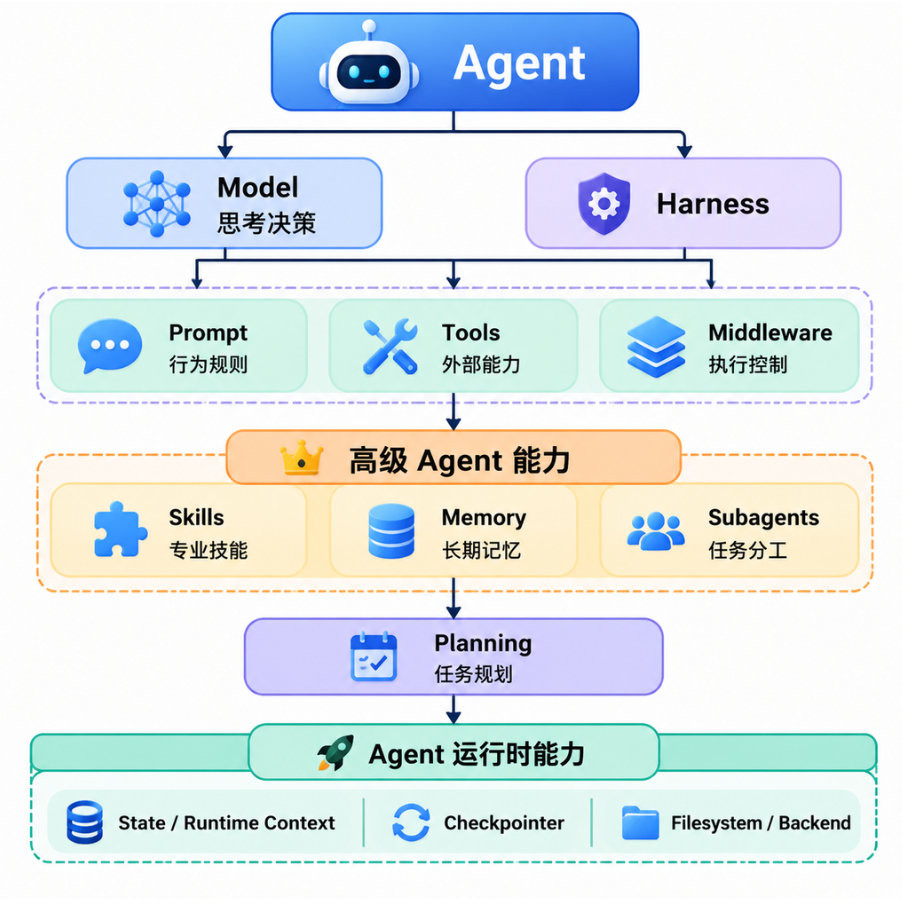

# LangChain Agent 完整架构：从基础 Agent 到 Deep Agents

## 一、什么是 Agent？

先看一个实际问题。

假设用户问：

> 帮我查询一下北京今天的天气，并告诉我适不适合出门。

普通大模型可以根据已有知识生成回答，但它无法凭空获取实时天气。

如果给大模型提供天气查询工具，情况就不一样了：

1. 大模型理解用户的问题。
2. 判断需要查询天气。
3. 选择天气查询工具。
4. 调用工具获取天气数据。
5. 根据查询结果生成回答。

这就是 Agent 要解决的问题。

**Agent（智能体）可以理解为：让大模型能够根据任务需要，选择工具、执行操作，并根据执行结果继续完成任务的一套机制。**

它并不是一种新的大模型，而是建立在大模型之上的一套执行机制。

## 二、为什么需要 Agent？

### 1. 普通大模型

```text
用户输入问题
     ↓
   大模型
     ↓
  生成回答
     ↓
   返回用户
```

这种方式适合：

- 文本生成
- 内容总结
- 翻译
- 普通知识问答

但如果任务涉及外部数据或者实际操作，就需要其他能力。

例如查询数据库、搜索互联网、调用接口、执行 Python 代码等。

### 2. 引入 Agent

```text
       用户提出任务
             ↓
          Agent
             ↓
          调用模型
             ↓
       判断下一步做什么
             ↓
       是否需要调用工具？
          ↙       ↘
        需要       不需要
         ↓           ↓
      执行工具     返回回答
         ↓
      获取结果
         ↓
      再次调用模型
         ↓
      继续判断
```

**Agent 最重要的变化，就是让模型能够参与任务执行过程中的决策，而不只是生成最终答案。**

## 三、LangChain Agent 的整体架构

LangChain 官方将 Agent 概括为：

**Agent = Model + Harness**

这里的 Harness 可以理解为围绕模型组织起来的执行框架。

它负责给模型提供完成任务所需要的信息、工具和执行控制机制。

在基础 Agent 中，我们主要接触 Model、Prompt、Tools 和 Middleware。

而在 Deep Agents 中，官方进一步提供了 Skills、Memory、Subagents、Planning、文件系统等能力。

先看完整的架构关系：



需要注意：这张图是为了理解整个技术体系而整理的概念图，并不是官方给出的严格类继承关系。

尤其是 Skills、Memory、Subagents 和 Planning，它们主要是 Deep Agents 提供的高级能力，但不是基础 `create_agent()` 必须配置的参数。

## 四、基础 Agent 的核心组成

### 1. Model：负责思考和决策

Model 就是底层的大语言模型，也是 Agent 的决策核心。

它主要负责：

- 理解用户的问题。
- 分析当前任务。
- 判断是否需要调用工具。
- 选择合适的工具。
- 生成工具调用参数。
- 根据工具执行结果决定下一步操作。

例如，模型可能生成：

```json
{
  "name": "get_weather",
  "arguments": {
    "city": "北京"
  }
}
```

这表示模型决定调用 `get_weather` 工具，并提供对应参数。

这里需要注意：

**模型负责决定调用什么工具，但真正执行工具的是 Agent 的执行机制，而不是模型本身。**

### 2. Prompt：告诉模型应该怎么做

Prompt 可以理解为给模型提供的任务说明和行为规则。

例如：

```text
你是一个天气助手。

你的任务是帮助用户查询天气。

规则：
1. 用户询问实时天气时，使用天气查询工具。
2. 不允许编造天气数据。
3. 获取天气结果后，再向用户解释。
4. 如果工具查询失败，需要如实告知用户。
```

在 LangChain 中，可以通过 `system_prompt` 设置系统提示词：

```python
from langchain.agents import create_agent

agent = create_agent(
    model="你的模型",
    tools=[],
    system_prompt="你是一个专业的天气助手。"
)
```

Prompt 负责引导模型，但不能保证模型一定遵守所有规则。权限、安全、调用次数等必须严格执行的要求，需要结合程序和 Middleware 控制。

### 3. Tools：给 Agent 提供外部能力

Tools 是 Agent 与外部系统交互的桥梁。

例如：

| 工具 | 作用 |
|---|---|
| 天气查询工具 | 获取天气信息 |
| 搜索工具 | 搜索互联网内容 |
| 数据库工具 | 查询数据库 |
| 邮件工具 | 发送邮件 |
| Python 工具 | 执行 Python 代码 |
| 文件工具 | 读取和写入文件 |

LangChain 可以通过 `@tool` 装饰器定义工具：

```python
from langchain.tools import tool


@tool
def get_weather(city: str) -> str:
    """查询指定城市的天气。"""

    weather_data = {
        "北京": "晴天，25℃",
        "上海": "多云，28℃",
        "深圳": "小雨，30℃"
    }

    return weather_data.get(city, "暂无天气数据")
```

这里需要理解：

- `@tool`：将普通 Python 函数转换成 LangChain 工具。
- 函数名称：作为工具名称。
- 函数参数：告诉模型调用时需要提供什么参数。
- 文档字符串：描述工具用途，帮助模型判断什么时候使用。
- 函数返回值：作为工具执行结果返回给 Agent。

模型通过 Tool Calling 生成工具名称和参数，LangChain 再根据这些信息找到对应的工具并执行。

### 4. Middleware：控制和扩展 Agent 的执行过程

Agent 在生产环境中会遇到很多问题：

- 模型接口调用失败怎么办？
- 工具执行超时怎么办？
- 如何限制模型调用次数？
- 如何避免敏感信息泄露？
- 重要操作是否需要人工确认？
- 对话历史太长怎么办？

这些问题很难只依靠 Prompt 解决。

因此，LangChain 提供 Middleware（中间件）机制。

**Middleware 可以理解为：在 Agent 执行过程中的关键位置增加处理逻辑，从而控制和扩展 Agent 的行为。**

例如：

| Middleware | 主要作用 |
|---|---|
| ModelRetryMiddleware | 模型调用失败时重试 |
| ToolRetryMiddleware | 工具调用失败时重试 |
| ModelCallLimitMiddleware | 限制模型调用次数 |
| ToolCallLimitMiddleware | 限制工具调用次数 |
| SummarizationMiddleware | 总结较长的对话历史 |
| PIIMiddleware | 检测或处理个人敏感信息 |
| HumanInTheLoopMiddleware | 重要操作交给人工审核 |

示例：

```python
from langchain.agents import create_agent
from langchain.agents.middleware import (
    ModelRetryMiddleware,
    ToolRetryMiddleware
)

agent = create_agent(
    model="你的模型",
    tools=[],
    middleware=[
        ModelRetryMiddleware(max_retries=3),
        ToolRetryMiddleware(max_retries=2)
    ]
)
```

Middleware 的价值在于：把重试、限流、安全检查等通用逻辑从业务代码中分离出来。

## 五、Agent 的运行时状态与上下文

Agent 不仅需要执行任务，还需要保存信息、传递运行参数，并在必要时恢复之前的执行状态。

这里涉及三个重要概念。

### 1. State：保存 Agent 执行过程中的状态

例如：

```text
用户提出问题
     ↓
模型产生工具调用请求
     ↓
工具执行
     ↓
工具返回结果
     ↓
模型生成最终回答
```

Agent 需要保存每一步产生的信息。

在 LangChain Agent 中，默认使用的状态类型是 `AgentState`，其中最重要的字段是 `messages`。

```text
messages
   │
   ├── HumanMessage
   │     用户提出的问题
   │
   ├── AIMessage
   │     模型产生的工具调用请求
   │
   ├── ToolMessage
   │     工具执行结果
   │
   └── AIMessage
         模型最终回答
```

一个默认的 `AgentState` 通常包含以下核心字段，每个字段都承担着特定的职责:

| 字段                      | 作用                                                         | 关键机制                                                     |
| :------------------------ | :----------------------------------------------------------- | :----------------------------------------------------------- |
| **`messages`**            | 存储完整的**对话历史**（包括用户输入、AI 回复、工具结果）。  | 使用 `Annotated` 和 `add_messages` reducer，确保新消息被**追加**而非覆盖。 |
| **`jump_to`**             | 一个临时的**路由提示**，由中间件设置，用于指示下一步该流向哪里（如 `"tools"`、`"model"` 或 `"end"`）。 | 属于临时值（EphemeralValue），仅在当前步骤生效。             |
| **`structured_response`** | 当配置了结构化输出时，用于存储**解析后的结构化结果**。       | 该字段可被配置为从最终输出中**省略**（`OmitFromOutput`），以保持输出整洁。 |

此外，一些默认实现可能还会包含 `remaining_steps` 等用于控制循环的字段。


如果业务需要保存额外信息，可以扩展 AgentState：

```python
from langchain.agents import AgentState, create_agent
from langchain.tools import tool, ToolRuntime


# 1. 定义：继承 AgentState，加一个自定义字段
class MyState(AgentState):
    user_name: str


# 2. 读取：在工具中通过 runtime.state 拿到字段
@tool
def greet(runtime: ToolRuntime) -> str:
    """向用户打招呼。"""
    return f"你好，{runtime.state['user_name']}！"


# 3. 绑定：创建 Agent 时传入 state_schema
agent = create_agent(
    model="openai:gpt-5.5",
    tools=[greet],
    state_schema=MyState,
)

# 4. 调用：把自定义字段和 messages 一起传进去
result = agent.invoke({
    "messages": [{"role": "user", "content": "跟我打个招呼"}],
    "user_name": "小明",
})

print(result["messages"][-1].content)
# 输出：你好，小明！
```

**简单理解：State 就是 Agent 执行过程中使用的一份状态数据。**

### 2. Runtime Context：传递本次运行需要的参数

有些数据不是对话状态，而是本次运行时需要使用的参数。

例如：

- 当前用户 ID
- 用户权限
- 当前租户信息
- 功能开关
- 运行时配置

可以通过 Runtime Context 传递：

```python
from dataclasses import dataclass
from langchain.agents import create_agent
from langchain.tools import tool, ToolRuntime


# 1. 定义 Context 结构（普通 dataclass 即可）
@dataclass
class Context:
    user_name: str


# 2. 工具中通过 ToolRuntime 读取 context
@tool
def greet_user(runtime: ToolRuntime[Context]) -> str:
    """向当前用户打招呼。"""
    name = runtime.context.user_name
    return f"你好，{name}！很高兴为你服务。"


# 3. 创建 Agent，绑定 context_schema
agent = create_agent(
    model="openai:gpt-5.5",
    tools=[greet_user],
    context_schema=Context,          # 👈 绑定 Context 结构
)


# 4. 调用时通过 context 参数传入具体值
result = agent.invoke(
    {"messages": [{"role": "user", "content": "跟我打个招呼"}]},
    context=Context(user_name="小明"),  # 👈 依赖注入
)

print(result["messages"][-1].content)
# 输出：你好，小明！很高兴为你服务。
```

`state_schema` 和 `context_schema` 的区别

| 维度           | State                            | Runtime Context                           |
| :------------- | :------------------------------- | :---------------------------------------- |
| **一句话定位** | Agent 的“共享记忆”               | Agent 的“本次运行工具包”                  |
| **核心用途**   | 状态管理                         | 依赖注入                                  |
| **生命周期**   | 跨轮次持久（同一 thread）        | 单次调用有效                              |
| **可变性**     | 动态，随节点执行增量更新         | 静态，调用开始后不可变                    |
| **持久化**     | 可被 Checkpointer 保存           | 不持久化，调用结束即失效                  |
| **数据流向**   | 节点读取 → 返回增量 → 框架合并   | 调用时注入 → 节点只读访问                 |
| **典型类型**   | 继承 `AgentState` 的 `TypedDict` | `@dataclass`、`TypedDict`、Pydantic 均可  |
| **配置参数**   | `state_schema=MyState`           | `context_schema=MyContext`                |
| **传入方式**   | `invoke({...state字段...})`      | `invoke(..., context=MyContext(...))`     |
| **工具中访问** | `runtime.state["字段"]`          | `runtime.context.字段`                    |
| **典型字段**   | `messages`、中间结果、业务状态   | `user_id`、`db_conn`、`api_key`、开关标志 |

### 3. Checkpointer：保存和恢复执行状态

如果一次 Agent 调用结束后，希望后续调用能够恢复之前的对话状态，就需要 Checkpointer。

例如：

```python
from langchain.agents import create_agent
from langgraph.checkpoint.memory import InMemorySaver


agent = create_agent(
    model="你的模型",
    tools=[],
    checkpointer=InMemorySaver()
)
```

调用时传入相同的 `thread_id`：

```python
config = {
    "configurable": {
        "thread_id": "conversation-001"
    }
}

agent.invoke(
    {
        "messages": [
            {"role": "user", "content": "我叫小明"}
        ]
    },
    config=config
)

result = agent.invoke(
    {
        "messages": [
            {"role": "user", "content": "我叫什么？"}
        ]
    },
    config=config
)
```

由于两次调用使用相同的 `thread_id`，Agent 可以在 Checkpointer 的支持下恢复之前的状态。

注意：

- `InMemorySaver` 适合本地测试，程序重启后内存数据不会保留。
- 生产环境需要选择合适的持久化存储。
- Checkpointer 主要负责线程级状态保存，不等于跨所有会话的长期记忆。

## 六、Structured Output：让 Agent 返回固定格式的数据

普通大模型通常返回自然语言：

```text
北京今天晴天，气温25℃，比较适合外出。
```

但在实际开发中，我们可能希望模型返回固定格式的数据：

```json
{
  "city": "北京",
  "weather": "晴天",
  "temperature": 25,
  "suggestion": "适合外出"
}
```

这就是 Structured Output（结构化输出）。

LangChain 支持使用 Pydantic、Dataclass、TypedDict 等方式定义输出结构。

```python
from pydantic import BaseModel, Field
from langchain.agents import create_agent


class WeatherResult(BaseModel):
    city: str = Field(description="城市名称")
    weather: str = Field(description="天气情况")
    temperature: int = Field(description="气温")
    suggestion: str = Field(description="出行建议")


agent = create_agent(
    model="你的模型",
    tools=[],
    response_format=WeatherResult
)

result = agent.invoke({
    "messages": [
        {
            "role": "user",
            "content": "北京今天晴天，25度，适合出门吗？"
        }
    ]
})

print(result["structured_response"])
```

重点关注：

- `WeatherResult`：定义期望的数据结构。
- `response_format`：指定 Agent 的输出格式。
- `structured_response`：获取结构化输出结果。

LangChain 主要提供 ProviderStrategy 和 ToolStrategy 两种策略。

结构化输出适合将模型结果保存到数据库、向前端返回固定格式数据，或者交给其他程序继续处理。

它是可选功能，不是 Agent 执行循环的必经步骤。

## 七、Agent 的核心工作机制：循环执行

LangChain Agent 的核心执行过程主要包括两个步骤：

1. Model Call：调用模型。
2. Tool Execution：执行模型请求调用的工具。

这两个步骤会不断循环，直到模型认为任务已经完成。

例如，用户提出：

> 帮我查询北京今天的天气，并告诉我适不适合出门。

### 第一步：接收用户问题

Agent 接收用户输入，将消息放入当前 State。

### 第二步：调用模型

模型根据用户问题、系统提示词和可用工具，判断下一步应该做什么。

发现需要实时天气，于是生成天气查询工具调用请求。

### 第三步：执行工具

Agent 根据模型返回的工具调用请求，找到对应工具并执行。

```python
get_weather("北京")
```

工具返回：

```text
晴天，25℃
```

### 第四步：将工具结果交给模型

Agent 将工具执行结果保存到 State 中，再次调用模型。

此时模型可以看到用户原来的问题、工具调用请求和工具返回结果。

### 第五步：生成最终回答

模型发现已经获取所需数据，不需要继续调用工具，于是生成最终回答。

```text
北京今天是晴天，气温25℃。

天气比较适宜，适合外出活动。
```

整个过程：

```text
           START
              │
              ▼
         Model Node
              │
              ▼
        判断模型返回结果
              │
       ┌──────┴──────┐
       │             │
    工具调用       最终回答
       │             │
       ▼             ▼
   Tools Node       END
       │
       ▼
   工具执行结果
       │
       ▼
   更新 messages
       │
       └───────────┐
                   │
                   ▼
              Model Node
```

**Agent 的核心就是模型调用和工具执行之间不断循环，直到任务完成。**

## 八、Deep Agents：更完整的 Agent 架构

前面介绍的是基础 Agent。

但当任务变得复杂时，仅仅具备 Model、Prompt、Tools 和 Middleware 还不够。

例如：

> 帮我研究新能源汽车行业，分析市场规模、技术发展和主要竞争对手，最后生成一份完整的行业报告。

这个任务可能需要：

- 拆分多个子任务。
- 搜集大量资料。
- 加载不同领域的专业知识。
- 保存研究过程中的信息。
- 让多个 Agent 分工协作。
- 最后汇总生成报告。

如果让一个基础 Agent 独自完成所有事情，可能会遇到上下文过长、任务难以管理、专业能力不足等问题。

为此，LangChain 生态提供了 Deep Agents。

**Deep Agents 是建立在 LangChain 和 LangGraph 之上的更完整的 Agent Harness，提供任务规划、上下文管理、子 Agent 委派和长期记忆等高级能力。**

它不是简单地给基础 Agent 增加几个参数，而是提供了一套面向复杂任务的完整执行框架。

Deep Agents 主要增加以下能力：

| 能力 | 主要作用 |
|---|---|
| Planning | 将复杂任务拆分成多个步骤 |
| Skills | 按需加载专业知识和操作规范 |
| Memory | 保存跨会话的信息 |
| Subagents | 将任务委派给其他 Agent |
| Filesystem | 通过文件管理任务资料和上下文 |
| Context Management | 控制上下文规模，避免上下文过长 |

下面重点介绍其中几个核心能力。

### 1. Planning：任务规划

Planning 可以理解为 Agent 在执行复杂任务之前，先制定一个执行计划。

例如用户提出：

> 帮我研究新能源汽车行业，并生成一份行业分析报告。

Agent 可以先拆分为：

```text
任务：生成新能源汽车行业分析报告

1. 搜集新能源汽车市场数据
2. 分析行业发展趋势
3. 研究核心技术
4. 分析主要竞争对手
5. 汇总研究结果
6. 生成最终报告
```

在 Deep Agents 中，内置的 `write_todos` 工具可以帮助 Agent 创建、更新和跟踪任务清单。

这样 Agent 就不必只依靠模型当前的对话内容来记住所有待办事项。

需要注意：

Planning 负责规划和跟踪任务，不代表它本身就能完成每个任务。真正的执行仍然需要调用 Tools 或 Subagents。

### 2. Skills：让 Agent 掌握专业技能

Skills 可以理解为一套**可以按需加载的专业知识和操作指南**。

例如，一个编程 Agent 可以拥有：

```text
skills/
│
├── python-development/
│   └── SKILL.md
│
├── java-development/
│   └── SKILL.md
│
├── database-design/
│   └── SKILL.md
│
└── code-review/
    └── SKILL.md
```

每个 Skill 目录中可以包含：

- `SKILL.md`：技能说明和操作规范。
- `scripts/`：执行脚本。
- `references/`：参考文档。
- `assets/`：模板或其他资源。

例如 `python-development/SKILL.md`：

```markdown
---
name: python-development
description: Python 项目开发规范和最佳实践
---

# Python 开发规范

1. 遵循 PEP 8 规范。
2. 合理使用类型注解。
3. 使用虚拟环境管理依赖。
4. 对关键业务逻辑编写单元测试。
5. 优先使用清晰、可维护的代码结构。
```

Deep Agents 的 Skills 有一个很重要的特点：

**不是启动时就把所有 Skill 的完整内容加载到模型上下文中，而是先提供技能描述，在任务需要时再读取对应的完整说明。**

例如：

```text
用户：帮我开发一个 Python 接口
             │
             ▼
          Agent
             │
             ▼
       判断需要 Python 技能
             │
             ▼
       加载 python-development
             │
             ▼
       按照技能规范完成任务
```

这样既可以扩展 Agent 的专业能力，又能减少不必要的上下文占用。

在 Deep Agents 中，可以通过 `skills` 参数指定技能目录：

```python
from deepagents import create_deep_agent

agent = create_deep_agent(
    model="你的模型",
    skills=["./my-project/skills/"]
)
```

注意：这里传入的是包含各个 Skill 子目录的目录，而不是直接传入某个 `SKILL.md` 文件路径。

Skills 主要解决的问题：

- 专业知识如何组织？
- 如何复用不同领域的操作规范？
- 如何避免一次性加载过多 Prompt 内容？

### 3. Memory：让 Agent 能够记住信息

Memory 是 Agent 的记忆机制。

例如：

第一次对话：

> 我正在开发一个基于 Flask 的后端项目，数据库使用 MySQL。

第二次对话：

> 帮我设计一个用户管理接口。

如果 Agent 能够使用之前保存的信息，就可以结合 Flask 和 MySQL 的技术背景给出方案。

在 Deep Agents 中，官方提供了基于文件系统的长期记忆机制。

Agent 可以读取和写入记忆文件，文件由 Backend 决定保存在哪里。

例如：

```text
memories/
│
├── user-profile.md
│
├── project-info.md
│
└── preferences.md
```

其中：

`user-profile.md`

```markdown
# 用户信息

用户主要使用 Python 开发后端项目。

用户熟悉 Flask 和 SQLAlchemy。
```

`project-info.md`

```markdown
# 项目信息

当前项目使用 Flask。

数据库使用 MySQL。

项目采用分层架构。
```

当后续任务需要这些信息时，Agent 可以读取对应的记忆文件。

Deep Agents 可以通过 `memory` 参数指定记忆文件：

```python
from deepagents import create_deep_agent

agent = create_deep_agent(
    model="你的模型",
    memory=["/memories/AGENTS.md"]
)
```

实际使用时，还需要配置能够持久化保存这些文件的 Backend。

这里需要特别区分三种概念：

| 概念 | 主要作用 | 保存范围 |
|---|---|---|
| State | 保存当前 Agent 执行状态 | 当前执行线程 |
| Checkpointer | 持久化线程状态和检查点 | 同一个 thread |
| Memory | 保存跨会话可复用的信息 | 可跨 thread |

另外，Skills 和 Memory 虽然都可能通过文件组织，但用途不同：

- Skills 更偏向程序性知识：告诉 Agent 应该怎么做。
- Memory 更偏向事实性信息：告诉 Agent 之前发生过什么、已经知道什么。

### 4. Subagents：让多个 Agent 分工合作

Subagents 就是子智能体。

当任务比较复杂时，可以由一个主 Agent 负责整体协调，再把不同任务交给专业子 Agent。

例如：

```text
                 主 Agent
                    │
               分析用户任务
                    │
                制定执行计划
                    │
        ┌───────────┼───────────┐
        │           │           │
        ▼           ▼           ▼
     市场分析     技术分析     竞品分析
     Subagent    Subagent    Subagent
        │           │           │
        ▼           ▼           ▼
     市场数据     技术资料     竞争信息
        │           │           │
        └───────────┼───────────┘
                    │
                    ▼
                主 Agent
                    │
                汇总分析
                    │
                    ▼
                 生成报告
```

每个子 Agent 可以拥有自己的：

- Model
- System Prompt
- Tools
- Middleware
- Skills

主 Agent 负责：

1. 判断是否需要委派任务。
2. 选择合适的子 Agent。
3. 把任务交给子 Agent。
4. 接收子 Agent 返回的结果。
5. 汇总结果并继续执行。

Deep Agents 支持通过 `subagents` 参数定义子 Agent。

例如：

```python
from deepagents import create_deep_agent


def internet_search(query: str) -> str:
    """搜索互联网信息。"""
    return f"关于 {query} 的搜索结果"


research_subagent = {
    "name": "research-agent",
    "description": "负责深入研究和搜索资料",
    "system_prompt": "你是一名专业的研究员。",
    "tools": [internet_search]
}


agent = create_deep_agent(
    model="你的模型",
    subagents=[research_subagent]
)
```

这里的几个字段：

| 参数 | 作用 |
|---|---|
| name | 子 Agent 的名称 |
| description | 描述子 Agent 负责什么任务 |
| system_prompt | 子 Agent 的行为规则 |
| tools | 子 Agent 可以使用的工具 |
| model | 可以为子 Agent 单独指定模型 |
| skills | 可以为子 Agent 指定技能目录 |

还有一个重要概念：**上下文隔离**。

默认情况下，子 Agent 使用独立的上下文，只接收主 Agent 委派的任务，而不是直接获取主 Agent 的全部对话历史。

这样做有两个好处：

- 子 Agent 可以专注于自己的任务。
- 大量中间搜索结果不会全部堆积到主 Agent 的上下文中。

子 Agent 完成任务后，将结果返回给主 Agent。

因此，Subagents 不只是多个模型同时运行，而是一种有明确任务边界的 Agent 协作机制。

## 九、Deep Agents 的整体工作流程

把前面几个高级能力组合起来，就能看到一个更完整的 Agent 执行过程。

例如：

> 帮我研究新能源汽车行业，并生成一份行业报告。

```text
                  用户提出任务
                       │
                       ▼
                    主 Agent
                       │
                       ▼
                  Planning 规划
                       │
                       ▼
                 拆分研究任务
                       │
          ┌────────────┼────────────┐
          │            │            │
          ▼            ▼            ▼
       市场研究      技术研究      竞品研究
       Subagent     Subagent     Subagent
          │            │            │
          ▼            ▼            ▼
       加载技能      加载技能      加载技能
          │            │            │
          ▼            ▼            ▼
       搜集资料      搜集资料      搜集资料
          │            │            │
          └────────────┼────────────┘
                       │
                       ▼
                  返回研究结果
                       │
                       ▼
                    主 Agent
                       │
                       ▼
                   汇总和分析
                       │
                       ▼
                   更新 Memory
                       │
                       ▼
                   生成最终报告
```

在这个过程中：

- Planning：负责拆分和跟踪任务。
- Subagents：负责不同领域的具体研究。
- Skills：提供对应领域的专业知识和操作规范。
- Memory：保存可供后续任务使用的信息。
- Tools：执行搜索、数据查询和文件操作。
- Middleware：控制执行过程中的重试、安全和上下文管理。

这些能力并不是每个任务都必须使用，而是根据任务复杂度选择。

## 十、Agent 和普通工作流有什么区别？

普通工作流：

```text
接收订单
   ↓
查询订单
   ↓
检查库存
   ↓
计算价格
   ↓
生成订单
   ↓
结束
```

每一步要做什么，都是开发人员提前设计好的。

Agent：

```text
接收用户任务
     ↓
   大模型
     ↓
 根据当前情况判断
     ↓
 选择下一步操作
     ↓
 执行工具
     ↓
 根据结果继续判断
     ↓
 直到任务完成
```

| 对比 | 普通工作流 | Agent |
|---|---|---|
| 执行步骤 | 通常提前定义 | 可以动态选择 |
| 执行顺序 | 相对固定 | 可以变化 |
| 决策方式 | 主要由程序决定 | 主要由模型决定 |
| 灵活性 | 适合明确、固定的任务 | 适合步骤不完全确定的任务 |
| 可控性 | 通常更容易控制 | 需要额外约束和检查 |

实际项目中，两者经常组合使用：

**确定性的步骤交给程序，灵活的决策交给模型。**

## 十一、LangChain、LangGraph 和 Deep Agents 的关系

这三个概念需要区分清楚。

### 1. LangChain

LangChain 提供开发大模型应用的常用组件。

例如：

- Models
- Prompts
- Tools
- Agents
- Middleware

它帮助开发人员更方便地组织模型调用、工具使用和 Agent 开发。

### 2. LangChain Agent

LangChain Agent 提供了一套相对完整的基础 Agent 实现。

通过 `create_agent()`，可以配置模型、工具、Prompt 和 Middleware，快速创建能够循环调用工具的 Agent。

### 3. LangGraph

LangGraph 提供更底层的图执行能力。

开发人员可以自己定义：

- State：保存运行状态。
- Node：执行具体任务。
- Edge：决定节点之间如何流转。
- Conditional Edge：根据条件决定下一步执行哪个节点。
- Checkpointer：保存和恢复执行状态。

它适合复杂、有状态、需要精细控制的 Agent 和工作流。

### 4. Deep Agents

Deep Agents 是建立在 LangChain 核心组件和 LangGraph Runtime 之上的更完整的 Agent Harness。

它进一步封装了：

- Planning
- Skills
- Memory
- Subagents
- Filesystem
- Context Management

通过 `create_deep_agent()` 可以快速创建具备这些高级能力的 Agent。

整体关系：

```text
                 LangChain
             提供基础开发组件
                    │
          ┌─────────┴─────────┐
          │                   │
    create_agent()         LangGraph
     基础 Agent           图执行框架
          │                   │
          └─────────┬─────────┘
                    │
                Deep Agents
                    │
          ┌─────────┼─────────┐
          │         │         │
       Planning   Skills   Subagents
          │         │         │
        Memory   Filesystem  Context
```

这里要注意：

- `create_agent()` 本身也是基于 LangGraph 构建的。
- Deep Agents 不是 LangGraph 的替代品，而是基于 LangChain 和 LangGraph 提供更完整的 Agent Harness。
- 简单任务可以使用基础 Agent；复杂任务可以考虑 Deep Agents；如果需要完全自定义执行流程，可以直接使用 LangGraph。

## 十二、什么时候应该使用 Agent？

并不是所有大模型应用都需要 Agent。

| 场景 | 推荐方式 | 原因 |
|---|---|---|
| 普通文本生成 | 直接调用模型 | 不需要复杂执行逻辑 |
| 文本翻译 | 直接调用模型 | 步骤固定 |
| 固定知识库问答 | RAG | 检索流程相对明确 |
| 实时信息搜索 | 基础 Agent | 需要根据问题选择工具 |
| 数据库查询助手 | 基础 Agent | 需要根据问题动态生成查询 |
| 自动化任务助手 | Agent | 需要动态选择操作 |
| 多步骤行业研究 | Deep Agents | 需要规划、委派和上下文管理 |
| 大型代码开发任务 | Deep Agents | 需要技能、文件管理和子 Agent 协作 |
| 复杂业务流程 | LangGraph | 需要精细控制节点和流程 |

一个简单的判断标准：

**如果任务执行步骤比较固定，优先考虑普通程序或工作流；如果需要根据任务动态决定下一步，可以考虑 Agent；如果还涉及复杂规划、长期运行和多 Agent 协作，可以进一步考虑 Deep Agents。**

## 十三、总结

学习 LangChain Agent，可以分成两个层次。

### 第一层：基础 Agent

先理解：

1. Model：大模型负责理解问题和决定下一步。
2. Prompt：告诉模型任务目标和行为规则。
3. Tools：为模型提供外部操作能力。
4. Middleware：控制和扩展 Agent 执行过程。
5. State：保存 Agent 执行状态。
6. Runtime Context：传递本次运行所需参数。
7. Checkpointer：保存和恢复线程状态。
8. Structured Output：让 Agent 返回固定格式的数据。

其中最重要的是理解 Agent 的执行循环：

**调用模型 → 判断是否需要调用工具 → 执行工具 → 将结果交给模型 → 继续判断 → 返回最终结果。**

### 第二层：高级 Agent 能力

再理解：

1. Planning：将复杂任务拆分成多个步骤。
2. Skills：按需加载专业知识和操作规范。
3. Memory：保存跨会话可复用的信息。
4. Subagents：将任务委派给其他 Agent。
5. Filesystem：管理任务文件和上下文。
6. Context Management：控制上下文规模。

这部分主要对应 Deep Agents 的能力体系。

最后记住一句话：

**基础 Agent 解决的是如何让大模型调用工具完成任务；Deep Agents 进一步解决的是如何让 Agent 规划复杂任务、掌握专业技能、保存长期信息，并通过多个子 Agent 协作完成工作。**

## 官方文档

### LangChain 基础 Agent

1. [Agents](https://docs.langchain.com/oss/python/langchain/agents)
2. [Models](https://docs.langchain.com/oss/python/langchain/models)
3. [Tools](https://docs.langchain.com/oss/python/langchain/tools)
4. [Middleware](https://docs.langchain.com/oss/python/langchain/middleware)
5. [Structured Output](https://docs.langchain.com/oss/python/langchain/structured-output)

### Deep Agents 高级能力

1. [Deep Agents Overview](https://docs.langchain.com/oss/python/deepagents/overview)
2. [Skills](https://docs.langchain.com/oss/python/deepagents/skills)
3. [Memory](https://docs.langchain.com/oss/python/deepagents/memory)
4. [Subagents](https://docs.langchain.com/oss/python/deepagents/subagents)
5. [Backends](https://docs.langchain.com/oss/python/deepagents/backends)
6. [LangGraph Overview](https://docs.langchain.com/oss/python/langgraph/overview)
