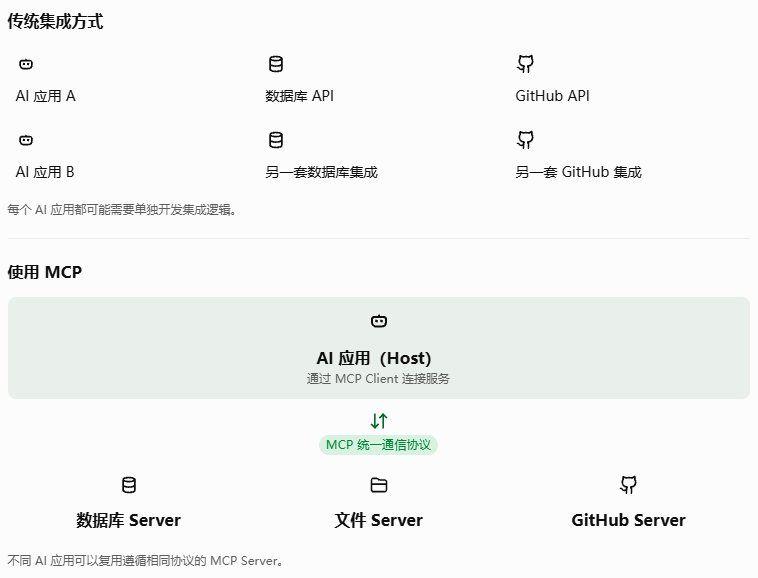
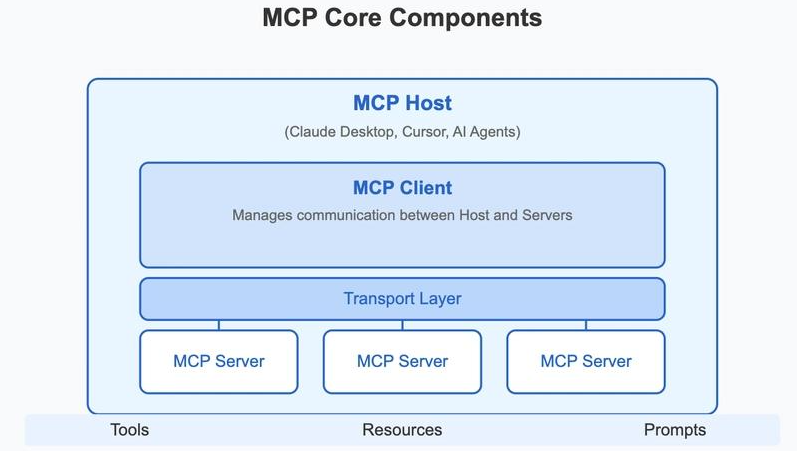
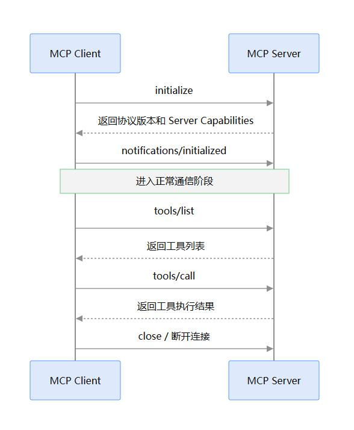
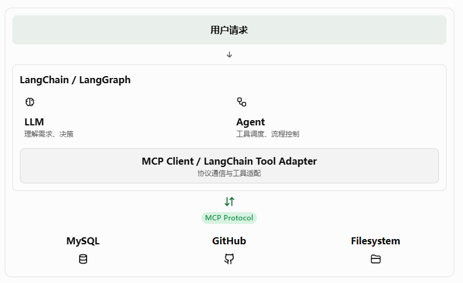

# MCP（Model Context Protocol）核心概念与原理详解

本文从 AI 应用开发的角度介绍 MCP，主要参考 MCP 官方文档和协议规范，重点讲解 MCP 的设计目的、架构、核心组件、通信机制以及 Python 实际开发方式。

学习完这篇文档，你应该能够理解：

- MCP 是什么，为什么需要 MCP？
- MCP 与 Function Calling、Tools 有什么区别？
- MCP Client、MCP Server、MCP Host 分别是什么？
- Tools、Resources、Prompts 三大核心能力有什么区别？
- MCP 是如何进行通信和交互的？
- MCP 的生命周期、传输方式和数据结构是什么？
- 如何使用 Python 开发 MCP Server 和 Client？
- MCP 在 Agent 架构中处于什么位置？

## 一、什么是 MCP？

### 1.1 MCP 的定义

MCP，全称 Model Context Protocol（模型上下文协议），是一个开放标准，用于规范 AI 应用与外部数据源、工具和服务之间的通信方式。

它解决的核心问题是：

如何让不同的 AI 应用，以统一的方式连接不同的外部系统？

举个例子。

假设我们正在开发一个基于 LangChain 的 Agent，希望它具备以下能力：

- 查询 MySQL 数据库。
- 读取本地文件。
- 搜索 GitHub 仓库。
- 查询天气。
- 调用第三方业务 API。

传统开发方式通常是：

1. 每接入一个外部系统，就编写对应的工具。
2. 每个工具都需要处理不同的 API 参数和返回结构。
3. 不同 AI 框架可能需要重新编写一套集成代码。
4. 如果其他 AI 应用也想使用这些能力，还需要重复开发。

这会导致大量重复的集成工作。

MCP 的解决思路是：定义一套统一的通信协议，让外部系统按照统一规范暴露能力，让 AI 应用按照统一规范发现和调用这些能力。




例如，我们可以开发一个 MySQL MCP Server，将数据库查询能力暴露出来。只要 AI 应用支持 MCP，就可以通过 MCP Client 连接它，而不需要重新实现一套 MySQL 集成逻辑。

### 1.2 MCP 的本质

可以从三个角度理解 MCP：

1. 协议标准：规定 Client 和 Server 应该如何通信。
2. 能力标准：规定 Server 如何向外提供工具、数据和提示词。
3. 集成标准：让不同厂商、不同框架开发的 AI 应用能够复用外部服务。

需要注意：

MCP 本身不是大语言模型，也不是 Agent 框架，更不是一个直接负责模型推理的系统。

它主要解决的是 AI 应用与外部能力之间的连接和上下文交换问题。

MCP 不规定 AI 应用应该如何使用 LLM，也不负责 Agent 的整体规划和执行逻辑


## 二、MCP 的整体架构

MCP 采用 Client-Server 架构，主要包含三个角色：

- MCP Host
- MCP Client
- MCP Server

### 2.1 MCP Host

MCP Host 是用户直接使用的 AI 应用，也是整个 MCP 系统的协调者。

例如：

- Claude Desktop
- Claude Code
- 支持 MCP 的 IDE
- 自己开发的 AI Agent 应用

Host 主要负责：

1. 接收用户输入。
2. 管理 LLM 的调用。
3. 管理 MCP Client。
4. 决定何时使用外部工具。
5. 将外部数据整合到模型上下文中。
6. 管理用户授权和安全边界。

可以简单理解为：Host 就是 AI 应用本身。

### 2.2 MCP Client

MCP Client 是 Host 内部负责 MCP 通信的组件。

它主要负责：

1. 与 MCP Server 建立连接。
2. 进行协议版本和能力协商（取决于协议版本）。
3. 发现 Server 提供的 Tools、Resources 和 Prompts。
4. 向 Server 发送请求。
5. 接收和解析 Server 返回的数据。

一个 Host 可以同时创建多个 MCP Client，每个 Client 通常维护与一个 MCP Server 的独立连接。

例如：

```txt
AI Host
  ├── MCP Client 1 → MySQL MCP Server
  ├── MCP Client 2 → GitHub MCP Server
  └── MCP Client 3 → Filesystem MCP Server
```

### 2.3 MCP Server

MCP Server 是能力提供方。

它负责将某个外部系统的功能按照 MCP 协议暴露出来。

例如：

| MCP Server        | 提供的能力           |
| ----------------- | -------------------- |
| MySQL Server      | 查询数据库、执行 SQL |
| GitHub Server     | 查询仓库、读取 Issue |
| Filesystem Server | 读取文件、创建文件   |
| Weather Server    | 查询天气信息         |
| Redis Server      | 查询缓存、操作 Redis |

MCP Server 不一定是一个远程服务器。

它可以是：

- 本地运行的 Python 程序。
- 本地运行的 Node.js 程序。
- 部署在云端的 HTTP 服务。

特别注意：MCP Server 通常不需要直接接触完整的 LLM 对话历史。

它只接收完成当前请求所需要的数据，由 Host 控制上下文的传递和安全边界。

### 2.4 三者之间的关系





用一个实际场景理解：

用户向 AI 应用提出问题：

> 帮我查询一下数据库中最近注册的 10 个用户。

整个过程：

1. Host 接收用户的问题。
2. Host 将可用的 MCP 工具信息提供给 LLM。
3. LLM 判断需要调用数据库查询工具。
4. Host 中的 MCP Client 将请求发送给 MySQL MCP Server。
5. MCP Server 执行 SQL 查询。
6. MCP Server 将查询结果返回给 Client。
7. Host 将结果交给 LLM。
8. LLM 根据结果生成自然语言回答。

这里有一个非常重要的认识：

MCP Client 负责通信，MCP Server 负责提供能力，Host 负责协调 AI 应用的整体执行流程。

## 三、MCP 的三大核心能力

MCP Server 可以向 Client 提供三种核心原语（Primitives）：

1. Tools（工具）
2. Resources（资源）
3. Prompts（提示词）

这三个概念是理解 MCP 最重要的知识点。

### 3.1 Tools：工具

Tools 用于向 AI 应用提供可以执行的操作。

例如：

- 查询数据库。
- 发送邮件。
- 创建 GitHub Issue。
- 调用第三方 API。
- 执行某个业务操作。

假设我们开发一个天气 MCP Server，可以提供一个工具：

```
get_weather(city: str)
```

它的作用是根据城市查询天气。

MCP Server 会向外暴露这个工具的名称、描述以及参数 Schema。

例如：

```json
{
  "name": "get_weather",
  "description": "根据城市查询天气",
  "inputSchema": {
    "type": "object",
    "properties": {
      "city": {
        "type": "string",
        "description": "城市名称"
      }
    },
    "required": ["city"]
  }
}
```

Client 发现这个工具后，可以将它提供给 LLM。

当 LLM 决定调用工具时，Host 会通过 MCP Client 向 Server 发送调用请求。

典型调用方法：

```
tools/list
tools/call
```

两者分别用于发现工具和执行工具。

注意：MCP 只规范工具的描述、发现和调用过程，并不负责决定 LLM 是否应该调用这个工具。

这个决策通常由 Host 中的 LLM 或 Agent 完成。


### 3.2 Resources：资源

Resources 用于向 AI 应用提供数据或上下文。

它与 Tools 最大的区别在于：

- Tools 侧重于执行操作。
- Resources 侧重于提供数据。

例如，一个数据库 MCP Server 可以提供：

```
database://schema/users
database://schema/orders
database://schema/products
```

这些 URI 分别代表用户表、订单表和商品表的结构信息。

Client 可以通过 Resource 接口读取这些数据。

典型方法：

```
resources/list
resources/read
```

其中：

- `resources/list`：获取可用资源列表。
- `resources/read`：读取指定资源内容。

Resources 还支持 Resource Templates，可以根据参数动态定位资源。

例如：

```
file:///{path}
```

可以通过不同的路径访问不同文件。

需要注意：Resources 不等于数据库，也不等于文件存储。它只是 MCP 对外暴露数据的一种标准化方式。

### 3.3 Prompts：提示词

Prompts 用于向 AI 应用提供可复用的提示词模板。

例如，我们开发了一个代码审查 MCP Server，可以提供：

```
review_code
```

这个 Prompt 可以接收代码作为参数，并生成一套代码审查模板。

例如：

```
请从以下几个方面审查代码：

1. 代码质量
2. 性能问题
3. 安全问题
4. 潜在 Bug

待审查代码：
{{code}}
```

典型方法：

```
prompts/list
prompts/get
```

其中：

- `prompts/list`：获取可用提示词。
- `prompts/get`：获取指定提示词及其参数填充后的消息。

### 3.4 三者的区别

| 对比         | Tools                | Resources            | Prompts        |
| ------------ | -------------------- | -------------------- | -------------- |
| 核心作用     | 执行操作             | 提供数据             | 提供提示词模板 |
| 主要用途     | 调用 API、操作数据库 | 读取文件、获取上下文 | 复用任务模板   |
| 是否执行操作 | 是                   | 通常是读取           | 获取模板       |
| 主要接口     | list / call          | list / read          | list / get     |
| 典型示例     | 查询订单             | 订单数据             | 订单分析模板   |

可以用一句话记忆：

- Tools：让 AI 能够做事情。
- Resources：让 AI 能够获取信息。
- Prompts：让 AI 能够复用预定义的交互模板。

这三种能力并不是互斥的。

例如，一个 MySQL MCP Server 可以同时提供：

- Tool：执行数据库查询。
- Resource：读取数据库表结构。
- Prompt：生成 SQL 查询模板。

## 四、MCP 的通信机制

前面介绍了 MCP 的三个角色和三大核心能力，接下来看看它们是如何通信的。

MCP 的通信主要分为两层：

1. Data Layer（数据层）
2. Transport Layer（传输层）

### 4.1 数据层（Data Layer）

数据层定义了 Client 和 Server 之间的消息格式、交互规则以及协议行为。

MCP 使用 JSON-RPC 2.0 作为基础消息协议。

JSON-RPC 是一种轻量级的远程过程调用协议，可以理解为：

客户端通过发送 JSON 消息，请求服务端执行某个操作，服务端执行后再返回结果。

例如，客户端请求查询可用工具：

```json
{
  "jsonrpc": "2.0",
  "id": 1,
  "method": "tools/list",
  "params": {}
}
```

服务端返回：

```json
{
  "jsonrpc": "2.0",
  "id": 1,
  "result": {
    "tools": [
      {
        "name": "get_weather",
        "description": "查询天气"
      }
    ]
  }
}
```

这里有几个重要字段：

| 字段    | 作用                         |
| ------- | ---------------------------- |
| jsonrpc | JSON-RPC 协议版本            |
| id      | 请求标识，用于匹配请求和响应 |
| method  | 要执行的方法                 |
| params  | 请求参数                     |
| result  | 成功时返回的结果             |
| error   | 失败时返回的错误             |

MCP 消息主要有三种类型：

**1.Request（请求）**

请求另一端执行操作，需要等待响应。

例如：

```
tools/list
tools/call
resources/read
prompts/get
```

**2.Response（响应）**

对 Request 的响应，通常包含 `result` 或 `error`。

**3.Notification（通知）**

单向消息，不需要对方返回响应。

例如：

- 工具列表发生变化。
- 资源列表发生变化。
- 任务执行进度发生变化。

这里需要理解一个细节：

Request 和 Response 是一组对应关系，而 Notification 不需要 Response。

### 4.2 传输层（Transport Layer）

数据层解决了消息应该长什么样的问题。

但消息如何从 Client 传递到 Server 呢？

这就是传输层负责的事情。

MCP 目前主要支持两种传输方式：

- stdio
- Streamable HTTP

另外还保留了旧版 HTTP + SSE 传输方式，用于兼容旧客户端。

#### 方式一：stdio

stdio 是标准输入输出通信方式。

它通常用于本地 MCP Server。

例如：

```
AI Host
   |
   | 启动子进程
   v
MCP Server
   |
   ├── stdin  接收客户端消息
   |
   └── stdout 返回服务端消息
```

实际过程：

1. AI Host 启动 MCP Server 对应的 Python 或 Node.js 程序。
2. MCP Server 作为子进程运行。
3. Client 将 JSON-RPC 消息写入 Server 的 stdin。
4. Server 处理请求。
5. Server 将响应写入 stdout。
6. Client 读取响应。

优点：

- 不需要额外部署 HTTP 服务。
- 不需要配置网络端口。
- 本地通信简单。
- 适合本地文件系统、开发工具等场景。

需要特别注意：

stdio 模式下，stdout 是 MCP 通信通道，不应该随意使用 print() 输出调试信息，否则可能破坏协议消息。

调试日志应该输出到 stderr，或者使用 logging。

#### 方式二：Streamable HTTP

Streamable HTTP 是目前推荐用于远程 MCP Server 的传输方式。

它基于 HTTP，可以通过网络连接远程 MCP Server。

例如：

```
AI Host
   |
   |
MCP Client
   |
   | HTTP POST
   v
https://example.com/mcp
   |
   v
MCP Server
```

它的特点：

- 支持远程连接。
- 可以使用 HTTP 标准认证机制。
- 支持服务端通过 SSE 形式发送流式消息。
- 适合部署在云服务器上。
- 可以被多个客户端访问。

例如：

```
MCP Client
    |
    | POST /mcp
    v
Remote MCP Server
    |
    | JSON-RPC Response
    v
MCP Client
```

这里的 SSE（Server-Sent Events）是 HTTP 下的一种服务器推送机制，可以让服务端持续向客户端发送事件。

需要注意：

Streamable HTTP 不等于 SSE。

Streamable HTTP 是完整的传输方式，而 SSE 是它可以使用的一种流式消息传递机制。

#### 方式三：HTTP + SSE（旧版）

早期 MCP 使用 HTTP + SSE 实现远程通信。

其通信方式通常包含：

- SSE 连接：服务器向客户端推送消息。
- HTTP POST：客户端向服务器发送请求。

在 2025-03-26 的协议版本中，Streamable HTTP 取代了旧版 HTTP + SSE。

所以，新项目应该优先使用 Streamable HTTP，而不是继续使用旧版 SSE 传输。

MCP Python SDK+2

### 4.3 两种主要传输方式对比

| 对比           | stdio              | Streamable HTTP |
| -------------- | ------------------ | --------------- |
| 通信方式       | 标准输入输出       | HTTP            |
| 运行位置       | 通常本地           | 本地或远程      |
| 是否需要端口   | 不需要             | 通常需要        |
| 是否适合云部署 | 不适合常规远程部署 | 适合            |
| 典型场景       | 本地工具           | 远程业务服务    |

如何选择？

- 开发本地文件操作、IDE 工具：优先 stdio。
- 开发需要远程访问的业务 MCP 服务：优先 Streamable HTTP。

## 五、MCP 的完整工作流程

理解了架构和通信机制之后，我们把整个流程串联起来。

假设我们已经开发了一个天气 MCP Server，并暴露了 `get_weather` 工具。

用户提出问题：

> 帮我查询一下北京今天的天气。

整个执行流程如下：

> 1. 用户发送请求
>
>    用户向 AI Host 提出天气查询需求。
>
> 2. Host 调用 LLM
>
>    Host 将用户的问题和当前可用的工具信息提供给 LLM。
>
> 3. LLM 决定调用工具
>
>    LLM 根据用户需求，选择 `get_weather`，并生成参数：
>
>    ```
>    {"city": "北京"}
>    ```
>
> 4. MCP Client 发送请求
>
>    Host 将工具调用转换成 MCP 请求，通过传输层发送给 MCP Server。
>
>    ```
>    tools/call
>    ```
>
> 5. MCP Server 执行工具
>
>    Server 调用内部天气 API，获取北京的天气信息。
>
> 6. 返回执行结果
>
>    MCP Server 将结果通过 JSON-RPC 返回给 MCP Client。
>
> 7. LLM 整理结果
>
>    Host 将工具执行结果交给 LLM，LLM 组织成自然语言。
>
> 8. 返回用户
>
>    AI Host 将最终回答展示给用户。

这里有一个很容易混淆的地方：

LLM 并不会直接与 MCP Server 建立连接。

通常是 Host 管理 LLM 和 MCP Client，Client 再与 MCP Server 通信。

因此，完整链路可以概括为：

```
用户
 |
 v
AI Host
 |
 +------> LLM
 |
 +------> MCP Client
             |
             | MCP Protocol
             v
         MCP Server
             |
             v
         外部系统
```

LLM 负责理解需求和决定调用什么工具，MCP 负责规范工具能力的发现和调用通信。

## 六、MCP 的生命周期与能力协商

MCP 并不是简单地建立连接后就直接调用工具，它还定义了客户端和服务端的生命周期及能力协商机制。

这里需要注意：MCP 不同协议版本的生命周期有所不同。

### 6.1 传统初始化流程

在 `2025-11-25` 及更早的协议版本中，典型流程如下：



主要分为三个阶段：

第一阶段：初始化

Client 发送 `initialize` 请求，携带协议版本和客户端能力等信息。

Server 返回：

- 支持的协议版本。
- Server Capabilities。
- Server Info。

第二阶段：正常通信

Client 根据 Server 声明的能力，决定可以调用哪些接口。

例如：

- 支持 Tools，就可以调用 `tools/list` 和 `tools/call`。
- 支持 Resources，就可以调用 `resources/list` 和 `resources/read`。
- 支持 Prompts，就可以调用 `prompts/list` 和 `prompts/get`。

第三阶段：终止连接

双方关闭连接，释放相关资源。

### 6.2 什么是 Capabilities？

Capabilities 翻译为能力。

它的作用是告诉通信双方：

我支持哪些 MCP 功能，你可以向我发送哪些类型的请求。

例如：

```json
{
  "capabilities": {
    "tools": {
      "listChanged": true
    },
    "resources": {
      "subscribe": true,
      "listChanged": true
    },
    "prompts": {
      "listChanged": true
    }
  }
}
```

这里表示 Server 支持 Tools、Resources 和 Prompts 等能力。

Capabilities 并不等于工具列表。

它只是声明功能类别，具体有哪些工具还需要通过 `tools/list` 获取。

### 6.3 2026-07-28 协议版本的新变化

截至本文撰写时间，官方协议还引入了新的无状态生命周期模型。

`2026-07-28` 版本不再采用传统的 `initialize` / `notifications/initialized` 握手方式。

它通过 `server/discover` 进行服务发现，并在每个请求的 `_meta` 中携带协议版本和相关能力信息。

所以，阅读 MCP 文档或者开发 MCP Client 时，不要认为所有版本都必须执行传统初始化流程。

实际使用时，应当以双方支持的协议版本和 SDK 实现为准。

## 七、MCP 与 Function Calling 有什么区别？

这是一个非常重要的问题。

因为在使用 LangChain 或 OpenAI 等模型时，我们已经接触过 Function Calling。

那么，既然模型已经能够调用工具，为什么还需要 MCP？

首先需要明确：

Function Calling 和 MCP 解决的不是同一个层面的问题。

### 7.1 Function Calling

Function Calling 是模型调用外部函数的一种机制。

例如，我们向模型提供一个函数：

```python
def get_weather(city: str):    
    return f"{city} 今天晴天"
```

然后将函数的名称、描述、参数 Schema 提供给模型。

模型判断需要调用这个函数时，会返回结构化的工具调用信息。

应用程序接收到调用请求后，执行 Python 函数，再将结果返回模型。

整个过程：

```
LLM
 |
 | 生成工具调用请求
 v
AI 应用
 |
 | 执行 Python 函数
 v
外部 API
 |
 | 返回结果
 v
AI 应用
 |
 | 将结果交给 LLM
 v
LLM
```

### 7.2 MCP

MCP 解决的是外部工具如何被不同 AI 应用统一发现和调用的问题。

例如：

我们开发了一个天气 MCP Server。

这个 Server 暴露：

```
get_weather(city)
```

那么支持 MCP 的不同 AI 应用，就可以通过 MCP Client 连接这个 Server。

不需要每个 AI 应用都重新编写天气 API 的集成代码。

### 7.3 核心区别

| 对比             | Function Calling         | MCP                        |
| ---------------- | ------------------------ | -------------------------- |
| 定位             | 模型工具调用机制         | 外部能力通信协议           |
| 主要作用         | 让模型生成函数调用请求   | 统一发现和调用外部能力     |
| 关注点           | 函数描述、参数、调用结果 | Client、Server、通信、能力 |
| 是否负责执行函数 | 由应用执行               | Server 负责执行对应能力    |
| 是否需要网络通信 | 不一定                   | 通过定义的传输机制通信     |
| 跨应用复用       | 通常需要适配             | 可以复用 MCP Server        |

### 7.4 两者可以结合使用

实际上，MCP 和 Function Calling 并不冲突。

它们可以组成一个完整的 Agent 工具调用流程。

例如：

```
                 用户
                  |
                  v
               AI Host
                  |
                  v
                 LLM
                  |
                  | Function Calling
                  v
              AI Host
                  |
                  | MCP Client
                  v
             MCP Server
                  |
                  v
                MySQL
```

这里：

1. LLM 使用 Function Calling 决定调用哪个工具。
2. Host 接收模型生成的工具调用请求。
3. Host 使用 MCP Client 调用 MCP Server。
4. MCP Server 执行实际业务操作。
5. 执行结果返回给 LLM。

可以这样理解：

- Function Calling 解决模型如何表达工具调用意图。
- MCP 解决工具能力如何被应用发现、访问和调用。

这也是为什么 MCP 可以与 LangChain、LangGraph 等 Agent 框架结合使用。

## 八、MCP 与 LangChain 的关系

如果你正在使用 LangChain 开发 Agent，那么理解 MCP 与 LangChain 的关系就非常重要。

首先，两者的定位不同。

| 技术      | 主要定位                        |
| --------- | ------------------------------- |
| LangChain | LLM 应用开发框架                |
| LangGraph | Agent 工作流和状态管理框架      |
| MCP       | AI 应用与外部能力之间的通信协议 |

### 8.1 LangChain 负责什么？

LangChain 主要负责：

- 模型调用。
- Prompt 管理。
- Messages 管理。
- Tools 管理。
- Agent 构建。
- 中间件管理。
- 结构化输出。

例如，我们可以使用 LangChain 定义一个工具：

```python
from langchain.tools import tool

@tool
def get_weather(city: str) -> str:    
    """查询指定城市的天气"""    
    return f"{city} 今天晴天"
```

然后将它交给 Agent 使用。

### 8.2 MCP 负责什么？

MCP 负责把外部系统的能力标准化地暴露出来。

例如，某个 MCP Server 暴露了：

```
get_weather
search_news
get_stock_price
```

LangChain 应用可以通过 MCP Client 连接这个 Server，获取工具列表，并将这些工具转换成 LangChain 可以使用的工具对象。

这样，LangChain Agent 就可以使用 MCP Server 提供的能力。

### 8.3 两者结合的架构



这里有一个关键点：

MCP Server 并不是 LangChain Tool。

它们属于不同的抽象层。

MCP Server 提供的是符合 MCP 协议的能力，而 LangChain Tool 是 LangChain 框架中的工具抽象。

如果想让 LangChain Agent 使用 MCP Server 的工具，需要一个适配过程。


## 九、使用 Python 开发 MCP Server

理解原理之后，我们通过一个简单的例子来实际体验 MCP。

这里使用官方 Python SDK。

官方 SDK 当前稳定版本为 v2，要求 Python 3.11 或更高版本。

### 9.1 安装依赖

```
pip install "mcp[cli]"
```

### 9.2 创建 MCP Server

创建 `server.py`：

```python
from mcp.server import MCPServer

# 创建 MCP Server
mcp = MCPServer("Weather Server")


# 注册 Tool
@mcp.tool()
def get_weather(city: str) -> str:
    """
    根据城市查询天气
    """
    # 实际开发中可以在这里调用第三方天气 API
    return f"{city} 今天晴天，温度 25℃"


# 注册 Resource
@mcp.resource("weather://{city}")
def weather_resource(city: str) -> str:
    """
    获取指定城市的天气资源
    """
    return f"{city} 的天气数据：晴天，25℃"


# 注册 Prompt
@mcp.prompt()
def weather_analysis(city: str) -> str:
    """
    生成天气分析提示词
    """
    return f"请分析{city}的天气情况，并给出出行建议。"


if __name__ == "__main__":
    mcp.run()
```

这里使用了三个装饰器：

| 装饰器            | 作用       |
| ----------------- | ---------- |
| `@mcp.tool()`     | 注册工具   |
| `@mcp.resource()` | 注册资源   |
| `@mcp.prompt()`   | 注册提示词 |

你会发现，我们只需要编写普通 Python 函数，然后通过装饰器注册即可。

SDK 会根据函数名称、类型注解和 Docstring 等信息生成相应的协议描述及参数 Schema。

不需要自己编写 JSON-RPC 消息处理逻辑。

### 9.3 启动 MCP Server

执行：

```
uv run mcp dev server.py
```

该命令会启动 MCP Server，并打开 MCP Inspector。

MCP Inspector 是官方提供的调试工具，可以帮助我们：

- 查看 Server 提供的工具。
- 查看工具参数。
- 手动调用工具。
- 查看执行结果。
- 测试 Resources 和 Prompts。

### 9.4 使用 Streamable HTTP 启动

如果需要将 MCP Server 部署成 HTTP 服务，可以修改为：

```
if __name__ == "__main__":
    mcp.run(
        transport="streamable-http",
        host="127.0.0.1",
        port=8000
    )
```

启动后，客户端可以通过：

```
http://127.0.0.1:8000/mcp
```

连接 MCP Server。

### 9.5 创建 MCP Client

官方 Python SDK 同样支持创建 MCP Client。

例如：

```python
import asyncio

from mcp import Client


async def main():

    # 连接 MCP Server
    async with Client("http://127.0.0.1:8000/mcp") as client:

        # 获取工具列表
        tools = await client.list_tools()

        for tool in tools:
            print(tool.name, tool.description)

        # 调用工具
        result = await client.call_tool(
            "get_weather",
            {"city": "北京"}
        )

        print(result.content)


if __name__ == "__main__":
    asyncio.run(main())
```

这个例子展示了 MCP Client 最核心的两个操作：

```
client.list_tools()
```

获取 Server 提供的工具列表。

```
client.call_tool(name, arguments)
```

调用指定工具，并传递参数。

实际开发中，还可以使用：

```python
client.list_resources()
client.read_resource(uri)

client.list_prompts()
client.get_prompt(name, arguments)
```

分别用于发现和读取资源，以及发现和获取提示词。

需要注意，Client 的具体 API 应以所安装的 SDK 版本为准

## 十、MCP 的安全性

MCP 能够让 AI 应用访问外部系统，因此安全问题非常重要。

例如：

- MCP Server 可以查询数据库。
- MCP Server 可以读取本地文件。
- MCP Server 可以发送邮件。
- MCP Server 可以执行某些业务操作。

如果没有做好权限控制，就可能造成数据泄露或者未授权操作。

开发 MCP Server 时，需要重点关注以下方面。

### 10.1 身份认证

远程 MCP Server 应当验证客户端身份。

例如：

- OAuth 2.0 授权。
- Bearer Token。
- API Key。
- 其他符合部署场景的身份认证机制。

不能因为客户端能够连接 Server，就默认它拥有所有权限。

### 10.2 权限控制

不同用户应该拥有不同的访问权限。

例如：

```
普通用户
  ├── 查询用户信息
  └── 查询订单

管理员
  ├── 查询用户信息
  ├── 查询订单
  ├── 修改订单
  └── 删除订单
```

MCP Server 应当在真正执行操作时检查权限，而不能只依赖 LLM 的提示词限制。

### 10.3 工具参数校验

例如：

```
def delete_user(user_id: int):    ...
```

即使模型生成了一个合法的 `user_id`，Server 仍然需要检查：

- 用户是否存在。
- 当前调用者是否有权限。
- 是否允许删除该用户。
- 是否需要用户确认。

### 10.4 防止 Prompt Injection

MCP Server 返回的内容可能来自不可信的数据源。

例如：

数据库记录、网页内容、第三方 API 返回值，都可能包含恶意指令。

因此不能把工具返回的内容无条件视为可信指令。

Host 和 Agent 应当对外部内容进行适当隔离和处理。

### 10.5 最小权限原则

只提供完成任务所需要的能力。

例如：

如果一个 Agent 只需要查询订单，就没有必要给它提供删除订单的工具。

同时，本地文件系统 MCP Server 应限制可访问的目录，避免任意读取敏感文件。

官方规范也特别强调了授权、用户控制以及工具调用的安全边界。

## 十一、MCP 的优点与局限性

### 11.1 优点

**1.标准化**

不同 AI 应用可以使用统一协议连接外部系统，降低重复集成成本。

**2.可复用**

开发一次 MCP Server，可以供多个支持 MCP 的 AI 应用使用。

**3.模块化**

数据库、文件系统、GitHub 等不同能力可以拆分成独立的 MCP Server。

**4.易于扩展**

需要接入新的业务系统时，可以单独开发一个 MCP Server，而不必修改所有 AI 应用的核心业务代码。

**5.框架无关**

MCP 并不绑定 LangChain，也不绑定某个特定模型厂商。

### 11.2 局限性

**1.MCP 不会自动提升模型的智能程度**

它只是提供连接外部能力的标准协议。

**2.MCP 不负责 Agent 的规划与决策**

是否调用工具、调用哪个工具，通常还是由 LLM 和 Host 决定。

**3.增加了一层通信成本**

相较于直接调用本地 Python 函数，MCP 需要进行协议封装、消息传输和解析。

**4.需要考虑版本兼容**

不同 MCP SDK 和客户端可能支持不同协议版本或扩展能力。

**5.不能忽视安全问题**

MCP 让 AI 应用获得外部操作能力，也意味着需要更严格的认证、授权和审计机制。

## 十二、总结：如何正确理解 MCP？

学习完 MCP，我们可以把整个 AI Agent 系统拆成几个不同的层次：

| 层次       | 技术                    | 主要职责                   |
| ---------- | ----------------------- | -------------------------- |
| 模型层     | GPT、Claude、Gemini 等  | 理解、推理、生成           |
| Agent 层   | LangChain、LangGraph    | 规划、决策、执行流程       |
| 工具调用层 | Function Calling        | 表达模型的工具调用意图     |
| 通信协议层 | MCP                     | 标准化外部能力的发现和调用 |
| 服务层     | MySQL、GitHub、业务 API | 提供实际业务能力           |

这里有几个最值得记住的结论：

1. MCP 是一个开放的通信协议，不是 Agent 框架。
2. MCP 采用 Host、Client、Server 架构。
3. MCP Server 可以提供 Tools、Resources 和 Prompts 三种核心能力。
4. MCP 使用 JSON-RPC 2.0 定义消息交互。
5. stdio 主要用于本地通信，Streamable HTTP 适合远程部署。
6. MCP 和 Function Calling 不冲突，可以结合使用。
7. LangChain 可以通过 MCP Client 将 MCP Server 提供的工具集成到 Agent 中。

最后用一个简单的比喻：

可以把 LLM 看作大脑，把 Agent 看作负责规划和执行任务的工作系统，把 MCP 看作连接外部工具和数据源的标准接口。

MCP 不负责思考，而是让 AI 应用能够以统一的方式连接和使用外部世界的能力。