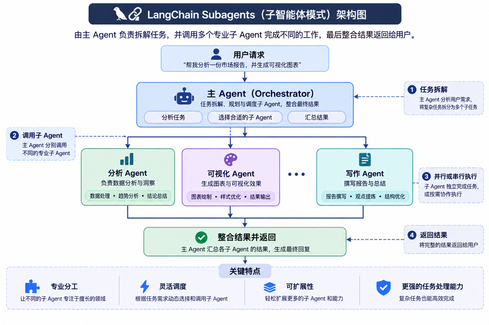
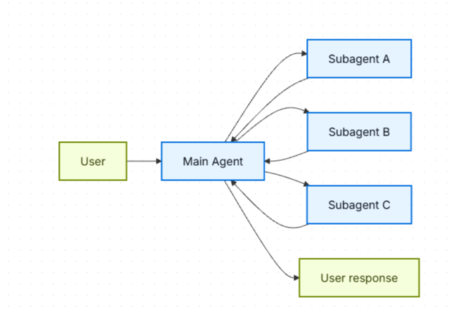
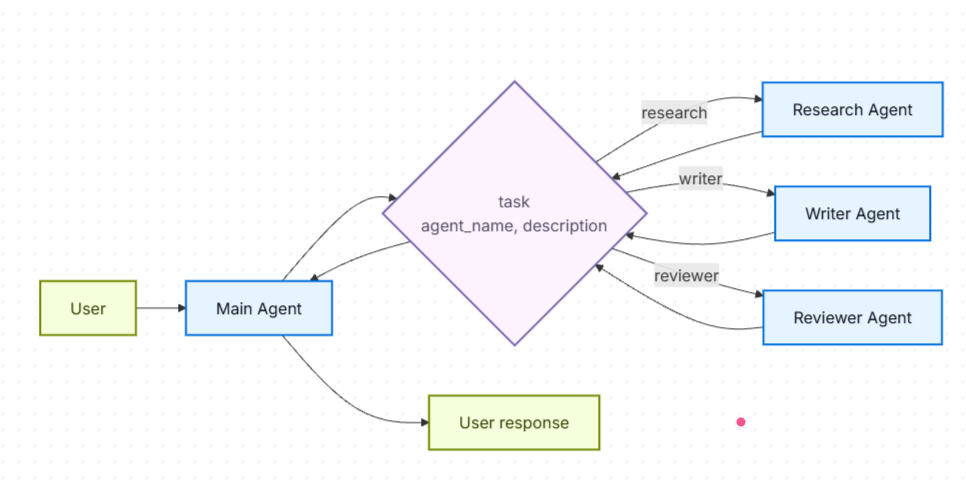
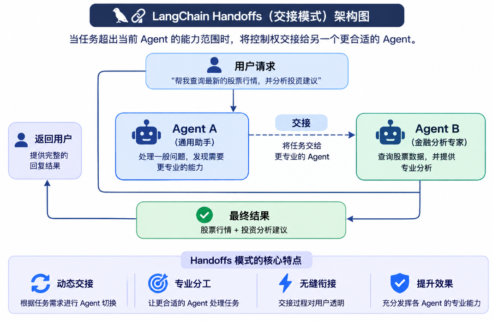
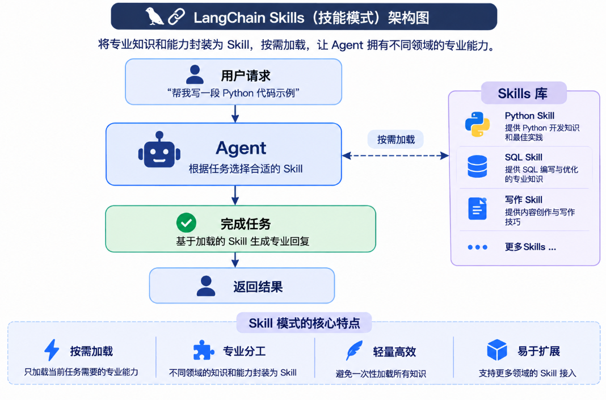
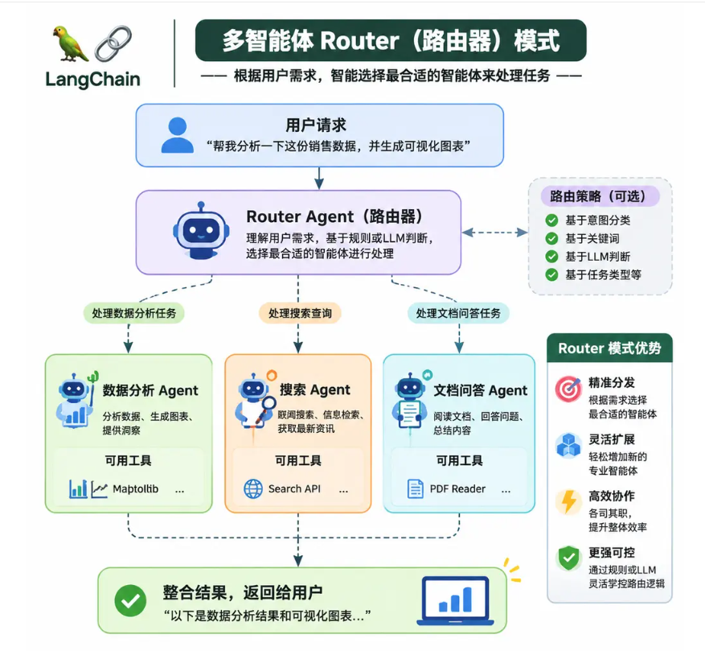

# LangChain 高级用法：Multi-Agent 多智能体架构详解

## 一、Multi-Agent 是什么？

### 1.1 基本概念

Multi-Agent（多智能体）系统是指：**由多个专业化的智能体（Agent）协同工作，共同完成复杂工作流的系统架构。**

单个 Agent 是"一个 LLM + 一组工具 + 一个提示词"构成的循环决策体。当任务变得复杂时，把所有能力塞进一个 Agent 会遇到瓶颈：工具太多导致模型选错、上下文超长导致成本爆炸、逻辑混杂导致难以维护。Multi-Agent 的思路就是**把复杂系统拆成多个各司其职的 Agent，再通过某种协调机制把它们组合起来**。

需要强调的一个官方观点：

**并不是所有复杂任务都需要 Multi-Agent。** 一个配置合理（工具可以动态加载）的单 Agent，往往能达到类似的效果。**Multi-Agent 是一种手段，不是目的。**

对于开箱即用的多智能体支持，官方提供了两条路径：

- **Managed Deep Agents**：构建在 LangChain 之上的托管式高层框架，内置 subagents、skills、规划、虚拟文件系统和上下文管理。
- **Deep Agents（自托管）**：使用同一套 Deep Agents 框架但自己托管，获得最大灵活性。

### 1.2 为什么需要 Multi-Agent？

多个 Agent 之间的通信、任务分配、上下文传递和结果整合都会增加系统开销。只有当任务复杂度、专业分工或者上下文隔离的需求足够明显时，才有必要考虑 Multi-Agent。

开发者说"我需要 multi-agent"时，通常真正想要的是以下一项或多项能力：

| 真实诉求 | 说明 |
| --- | --- |
| **上下文管理（Context Management）** | 向模型提供专业知识时不能撑爆上下文窗口。如果上下文无限、延迟为零，你可以把所有知识塞进一个 prompt——但现实不行，所以需要模式来"按需呈现"相关信息。 |
| **分布式开发（Distributed Development）** | 让不同团队独立开发和维护各自的能力模块，再以清晰的边界组合成更大的系统。 |
| **并行化（Parallelization）** | 为子任务派生专门的工作者（worker）并发执行，更快拿到结果。 |

Multi-Agent 模式在以下场景尤其有价值：

1. **单个 Agent 工具太多**：模型在选择用哪个工具时决策质量变差。
2. **任务需要专业知识且上下文量大**：每个领域都有很长的 prompt 和领域专属工具。
3. **需要强制执行顺序约束**：某些能力必须在满足前置条件后才能解锁。

### 1.3 Multi-Agent 设计的核心：上下文工程

**多智能体设计的中心是上下文工程（Context Engineering）——决定每个 Agent 能看到什么信息。**

系统的质量取决于：每个 Agent 在执行自己的任务时，能否拿到"恰到好处"的数据——不多也不少。每个 Agent 多看到的无关信息，都是成本、延迟和出错率。

## 二、五大架构模式总览

官方归纳了五种主要的 Multi-Agent 构建模式，各自适合不同的场景：

| 模式 | 工作方式 |
| --- | --- |
| **Subagents（子代理）** | 主 Agent 把子 Agent 当作工具来调用。所有路由都经过主 Agent，由它决定何时、如何调用每个子 Agent。 |
| **Handoffs（交接）** | 行为根据状态动态变化。工具调用更新一个状态变量，触发路由或配置变化，实现 Agent 间切换或当前 Agent 的工具/提示词调整。 |
| **Skills（技能）** | 专业化的提示词和知识按需加载。单个 Agent 始终保持控制权，按需从 skill 中加载上下文。 |
| **Router（路由器）** | 一个路由步骤对输入进行分类，并导向一个或多个专业化 Agent。结果被综合成统一的响应。 |
| **Custom Workflow（自定义工作流）** | 用 LangGraph 构建定制的执行流，混合确定性逻辑和 Agent 行为。可以把其他模式作为工作流中的节点嵌入。 |

### 2.1 选型对照表

用这张表把需求匹配到正确的模式（⭐越多越适合，"-"表示不适合）：

| 模式 | 分布式开发 | 并行化 | 多跳调用 | 与用户直接交互 |
| --- | --- | --- | --- | --- |
| **Subagents** | ⭐⭐⭐⭐ | ⭐⭐⭐ | ⭐⭐⭐ | - |
| **Handoffs** | ⭐ | ⭐ | ⭐⭐ | ⭐⭐⭐⭐ |
| **Skills** | ⭐⭐⭐⭐ | ⭐⭐⭐ | ⭐ | ⭐⭐⭐ |
| **Router** | ⭐⭐⭐ | ⭐⭐⭐⭐ | - | ⭐⭐ |

各维度含义：

- **分布式开发**：不同团队能否独立维护各个组件？
- **并行化**：多个 Agent 能否并发执行？
- **多跳（Multi-hop）**：该模式是否支持串联调用多个子 Agent？
- **与用户直接交互**：子 Agent 能否直接与用户对话？

> **模式可以混用！** 例如：Subagents 架构中可以调用"调用自定义工作流或 Router"的工具；子 Agent 内部还可以用 Skills 模式按需加载上下文。组合空间是无限的。

### 2.2 性能对比

不同模式有不同的性能特征。两个关键指标：

- **模型调用次数（Model calls）**：LLM 调用次数越多，延迟越高（尤其串行时）、单次请求 API 成本越高。
- **处理的总 Token 数（Tokens processed）**：所有调用的上下文窗口总用量，越多则处理成本越高，还可能触到上下文上限。

#### 场景一：单发请求（One-shot）

> 用户："买杯咖啡"（专门的咖啡 Agent/Skill 可以调用 `buy_coffee` 工具）

| 模式 | 模型调用次数 | 最优 |
| --- | --- | --- |
| Subagents | 4 | |
| Handoffs | 3 | ✅ |
| Skills | 3 | ✅ |
| Router | 3 | ✅ |

**要点**：单次任务中 Handoffs、Skills、Router 最高效（各 3 次调用）。Subagents 多一次调用，因为结果要回流到主 Agent——这个开销换来的是集中式控制。

#### 场景二：重复请求（Repeat request）

> 第 1 轮："买杯咖啡"；第 2 轮："再买一杯"

| 模式 | 第 2 轮调用 | 两轮总计 | 最优 |
| --- | --- | --- | --- |
| Subagents | 4 | 8 | |
| Handoffs | 2 | 5 | ✅ |
| Skills | 2 | 5 | ✅ |
| Router | 3 | 6 | |

**要点**：

- **Subagents 设计上是无状态的**：每次调用走完整流程。主 Agent 维护对话上下文，但子 Agent 每次都是全新开始。这提供强上下文隔离，代价是重复完整流程。
- **Handoffs**：咖啡 Agent 在第 1 轮后仍处于活跃状态（状态持久化），无需再次交接，直接调工具 + 回复，省 1 次调用。
- **Skills**：技能上下文已在对话历史中，无需重新加载，同样省 1 次调用。
- **Router 是无状态的**：每个请求都需要一次 LLM 路由调用。可以通过把它包成有状态 Agent 的工具来优化。

**结论**：有状态模式（Handoffs、Skills）在重复请求上节省 40-50% 的调用；Subagents 每次请求成本恒定，换来强上下文隔离。

#### 场景三：多领域请求（Multi-domain）

> 用户："对比 Python、JavaScript、Rust 在 Web 开发上的表现"（每个语言的 Agent/Skill 含约 2000 token 文档，所有模式都支持并行工具调用）

| 模式 | 模型调用 | 总 Token | 最优 |
| --- | --- | --- | --- |
| Subagents | 5 | ~9K | ✅ |
| Handoffs | 7+ | ~14K+ | |
| Skills | 3 | ~15K | |
| Router | 5 | ~9K | ✅ |

**要点**：

- **Subagents**：每个子 Agent 在隔离环境中只处理自己的相关上下文，总计约 9K token。
- **Handoffs 串行执行**：无法并行研究三种语言，且对话历史不断增长带来额外开销（~14K+）。
- **Skills**：加载后，后续每次调用都要处理全部 6K token 的技能文档，总计约 15K token——Subagents 因上下文隔离整体少用约 67% 的 token。
- **Router**：用 LLM 做路由，然后并行调用各 Agent，效果与 Subagents 类似。

**结论**：多领域任务中，支持并行执行的模式（Subagents、Router）最高效；Skills 调用次数少但 token 用量高（上下文累积）；Handoffs 在此场景效率最低。

#### 汇总

| 模式 | 单发请求 | 重复请求 | 多领域 |
| --- | --- | --- | --- |
| **Subagents** | 4 calls | 8 calls (4+4) | 5 calls, 9K tokens |
| **Handoffs** | 3 calls | 5 calls (3+2) | 7+ calls, 14K+ tokens |
| **Skills** | 3 calls | 5 calls (3+2) | 3 calls, 15K tokens |
| **Router** | 3 calls | 6 calls (3+3) | 5 calls, 9K tokens |

按优化目标选型：

| 优化目标 | Subagents | Handoffs | Skills | Router |
| --- | --- | --- | --- | --- |
| 单次请求 | | ✅ | ✅ | ✅ |
| 重复请求 | | ✅ | ✅ | |
| 并行执行 | ✅ | | | ✅ |
| 大上下文领域 | ✅ | | | ✅ |
| 简单聚焦任务 | | ✅ | | |

## 三、模式详解一：Subagents（子代理）

### 3.1 定义



**核心思想：由一个主 Agent 统一管理多个专业子 Agent。**

在 Subagents 架构中，一个中央主 Agent（常称 **supervisor**，监督者）**把子 Agent 当作工具来调用**，由它决定：

- 接收用户请求。
- 分析任务并决定是否需要拆分。
- 选择合适的子 Agent。
- 将任务交给子 Agent 执行。
- 获取子 Agent 的执行结果。
- 整合结果并回复用户。

**默认情况下子 Agent 是无状态的**——它们不记住过去的交互，所有对话记忆由主 Agent 维护。这带来**上下文隔离**：每次子 Agent 调用都在干净的上下文窗口中工作，防止主对话上下文膨胀。需要时也可以把主 Agent 的对话历史传给子 Agent（见"上下文工程"一节）。

例如，主 Agent 正在处理一个复杂的市场调研任务：

- Search Agent 搜索了大量网页。
- Analysis Agent 处理了大量市场数据。
- Writing Agent 生成了较长的报告。

如果所有操作都在主 Agent 的上下文中完成，就可能造成上下文不断膨胀。

使用 Subagents 后，每个子 Agent 可以在自己的上下文中完成任务，主 Agent 只需要接收必要的执行结果。

这样可以减少主 Agent 的上下文负担。

**关键特征：**

- **集中式控制**：所有路由都经过主 Agent
- **不与用户直接交互**：子 Agent 把结果返回主 Agent 而非用户（但可在子 Agent 内用 interrupts 允许用户交互）
- **通过工具调用触发**
- **支持并行**：主 Agent 可在一个回合内调用多个子 Agent

**Supervisor 与 Router 的区别**：Supervisor 是完整的 Agent，维护对话上下文，跨多个回合动态决定调用哪些子 Agent；Router 通常只是单个分类步骤，分发后不维护持续的对话状态。

### 3.2 适用场景

- 有多个不同的领域（日历、邮件、CRM、数据库等）
- 子 Agent 不需要直接与用户对话
- 需要集中式的工作流控制

如果只有少数几个工具的简单场景，直接用**单 Agent**即可。

> **子 Agent 内需要用户交互？** 可在子 Agent 中使用 **interrupts** 暂停执行、收集用户输入（适合需要澄清或审批的场景）。主 Agent 仍是编排者，但子 Agent 可以在任务中途向用户收集信息。

### 3.3 基础实现

```python
from langchain.tools import tool
from langchain.agents import create_agent

# 创建一个子 Agent
subagent = create_agent(model="google_genai:gemini-3.6-flash", tools=[...])

# 把它包装成一个工具
@tool("research", description="Research a topic and return findings")
def call_research_agent(query: str):
    result = subagent.invoke({"messages": [{"role": "user", "content": query}]})
    return result["messages"][-1].content

# 主 Agent 持有"子 Agent 工具"
main_agent = create_agent(model="google_genai:gemini-3.6-flash", tools=[call_research_agent])
```

### 3.4 设计决策总览

| 决策点 | 可选项 |
| --- | --- |
| **同步 vs 异步** | 同步（阻塞等待）vs 异步（后台运行） |
| **工具模式** | 每个 Agent 一个工具 vs 单一 dispatch 工具 |
| **子 Agent 规格** | 系统提示枚举 vs 枚举约束 vs 基于工具的发现（仅单一 dispatch） |
| **子 Agent 输入** | 仅查询 vs 完整上下文 |
| **子 Agent 输出** | 子 Agent 结果 vs 完整对话历史 |

### 3.5 同步 vs 异步

> 注意：这里的 "async" 不是 Python 的 `async`/`await`，而是指主 Agent 启动一个后台任务（通常在独立进程或服务中）并继续运行而不阻塞。

| 模式 | 主 Agent 行为 | 适用场景 | 权衡 |
| --- | --- | --- | --- |
| **Sync（默认）** | 等待子 Agent 完成 | 主 Agent 需要结果才能继续；任务有顺序依赖 | 简单，但阻塞对话 |
| **Async** | 子 Agent 后台运行，主 Agent 继续 | 独立任务；用户不应等待 | 响应快，但更复杂 |

**异步的三工具模式（Three-tool pattern）**：

1. **Start job**：启动后台任务，返回 job ID
2. **Check status**：返回当前状态（pending / running / completed / failed）
3. **Get result**：获取完成的结果

**处理任务完成通知**：任务完成后需要通知用户。一种做法：弹出通知，点击后发送一条 `HumanMessage`，例如 "Check job_123 and summarize the results."

### 3.6 工具模式

**将 Subagent作为工具的方式主要有两种**

#### 模式 A：每个 Agent 一个工具（Tool per agent）



适合细粒度控制每个子 Agent 的输入/输出。设置更多，但定制化更强。

```python
from langchain.tools import tool
from langchain.agents import create_agent

subagent = create_agent(model="...", tools=[...])

@tool("subagent_name", description="subagent_description")
def call_subagent(query: str):
    result = subagent.invoke({"messages": [{"role": "user", "content": query}]})
    return result["messages"][-1].content

main_agent = create_agent(model="...", tools=[call_subagent])
```

#### 模式 B：单一 dispatch 工具（Single dispatch tool）



用一个参数化工具调用临时（ephemeral）子 Agent，**约定式调用**：按名称选择 Agent，任务描述作为 human message 传入，子 Agent 的最终消息作为工具结果返回。

适用场景：

- 跨团队分布式开发 Agent
- 把复杂任务隔离到独立上下文窗口
- 无需修改协调器即可扩展新 Agent
- 偏好"约定优于配置"

它以牺牲上下文工程灵活性，换取组合简洁性和强上下文隔离。

**有趣的一点**：子 Agent 可能与主 Agent 拥有完全相同的能力。此时调用子 Agent 的**真正目的是上下文隔离**——让复杂多步任务在隔离的上下文窗口中运行，避免主对话历史膨胀，子 Agent 自主完成工作后只返回简洁摘要。

```python
from langchain.tools import tool
from langchain.agents import create_agent

# 不同团队开发的子 Agent
research_agent = create_agent(
    model="gpt-5.5",
    system_prompt="You are a research specialist..."
)
writer_agent = create_agent(
    model="gpt-5.5",
    system_prompt="You are a writing specialist..."
)

# 可用子 Agent 注册表
SUBAGENTS = {
    "research": research_agent,
    "writer": writer_agent,
}

@tool
def task(agent_name: str, description: str) -> str:
    """Launch an ephemeral subagent for a task.

    Available agents:
    - research: Research and fact-finding
    - writer: Content creation and editing
    """
    agent = SUBAGENTS[agent_name]
    result = agent.invoke({
        "messages": [{"role": "user", "content": description}]
    })
    return result["messages"][-1].content

# 主协调 Agent
main_agent = create_agent(
    model="gpt-5.5",
    tools=[task],
    system_prompt=(
        "You coordinate specialized sub-agents. "
        "Available: research (fact-finding), "
        "writer (content creation). "
        "Use the task tool to delegate work."
    ),
)
```

### 3.7 上下文工程（Context Engineering）

控制主 Agent 与子 Agent 之间的上下文流动，分三类：

| 类别 | 目的 | 影响 |
| --- | --- | --- |
| **Subagent specs（规格）** | 确保子 Agent 在该被调用时被调用 | 主 Agent 的路由决策 |
| **Subagent inputs（输入）** | 确保子 Agent 拿到优化的上下文并良好执行 | 子 Agent 性能 |
| **Subagent outputs（输出）** | 确保 supervisor 能基于子 Agent 结果继续行动 | 主 Agent 性能 |

#### （1）Subagent specs：名称与描述是核心杠杆

子 Agent 的**名称**和**描述**是主 Agent 判断调用哪个子 Agent 的主要依据——这是提示词杠杆，需谨慎选择：

- **Name**：清晰、面向动作（如 `research_agent`、`code_reviewer`）
- **Description**：具体说明处理什么任务、何时使用

单一 dispatch 设计中，向主 Agent 提供子 Agent 信息的三种方式：

| 方法 | 适用场景 | 权衡 |
| --- | --- | --- |
| **系统提示枚举** | 小型静态 Agent 列表（< 10） | 简单，但 Agent 变化时需更新提示 |
| **枚举约束（Enum）** | 小型静态 Agent 列表（< 10） | 类型安全、显式，但变化需改代码 |
| **基于工具的发现** | 大型或动态注册表 | 灵活可扩展，但增加复杂度 |

方式一：系统提示枚举

```python
main_agent = create_agent(
    model="...",
    tools=[task],
    system_prompt=(
        "You coordinate specialized sub-agents. "
        "Available agents:\n"
        "- research: Research and fact-finding\n"
        "- writer: Content creation and editing\n"
        "- reviewer: Code and document review\n"
        "Use the task tool to delegate work."
    ),
)
```

方式二：枚举约束

```python
from enum import Enum

class AgentName(str, Enum):
    RESEARCH = "research"
    WRITER = "writer"
    REVIEWER = "reviewer"

@tool
def task(agent_name: AgentName, description: str) -> str:
    """Launch an ephemeral subagent for a task."""
    ...
```

方式三：基于工具的发现（适合 Agent 数量 > 10、注册表频繁变化的场景）

```python
@tool
def list_agents(query: str = "") -> str:
    """List available subagents, optionally filtered by query."""
    agents = search_agent_registry(query)
    return format_agent_list(agents)

main_agent = create_agent(
    model="...",
    tools=[task, list_agents],
    system_prompt="Use list_agents to discover available subagents, then use task to invoke them."
)
```

#### （2）Subagent inputs：输入定制

```python
from langchain.agents import AgentState
from langchain.tools import tool, ToolRuntime

class CustomState(AgentState):
    example_state_key: str

@tool("subagent1_name", description="subagent1_description")
def call_subagent1(query: str, runtime: ToolRuntime[None, CustomState]):
    # 对消息做任意变换，构造合适的子 Agent 输入
    subagent_input = some_logic(query, runtime.state["messages"])
    result = subagent1.invoke({
        "messages": subagent_input,
        # 也可以传其他 state 键（需在主/子 Agent 的 state schema 中都定义）
        "example_state_key": runtime.state["example_state_key"]
    })
    return result["messages"][-1].content
```

**Isolated vs Forked 两种输入模式**：

| 模式 | 子 Agent 接收 | 适用场景 | 权衡 |
| --- | --- | --- | --- |
| **Isolated（默认）** | 仅任务描述 | 需要很少先验上下文的聚焦工作 | 上下文隔离，但需重新推导父 Agent 已做的工作 |
| **Forked** | 父 Agent 的对话历史（Deep Agents 中还含系统提示） | 继续父 Agent 已开始的工作（如继续 PR 审查、接续 bug 修复） | 带先验上下文启动，代价是更大的 prompt 和更少隔离 |

Deep Agents 将这两种模式命名为 `mode: "isolated"`（默认）和 `mode: "fork"`，并自动实现 fork：fork 的子 Agent 接收父 Agent 的完整消息历史（含工具调用）和系统提示。

#### （3）Subagent outputs：输出定制

两种策略：

1. **提示子 Agent**：明确指定应返回什么。常见失败模式：子 Agent 执行了工具调用或推理，但未在最终消息中包含结果——要提醒它 supervisor 只能看到最终输出。
2. **代码中格式化**：返回前调整或丰富响应，例如用 `Command` 传回额外状态键：

```python
from typing import Annotated
from langchain.agents import AgentState
from langchain.tools import InjectedToolCallId
from langgraph.types import Command
from langchain.messages import ToolMessage

@tool("subagent1_name", description="subagent1_description")
def call_subagent1(
    query: str,
    tool_call_id: Annotated[str, InjectedToolCallId],
) -> Command:
    result = subagent1.invoke({
        "messages": [{"role": "user", "content": query}]
    })
    return Command(update={
        # 传回子 Agent 的额外状态
        "example_state_key": result["example_state_key"],
        "messages": [
            ToolMessage(
                content=result["messages"][-1].content,
                tool_call_id=tool_call_id
            )
        ]
    })
```

### 3.8 Checkpointing 与状态检查

- 默认子 Agent 使用**继承式 checkpointer** 模式：每次调用从全新状态开始，支持 interrupts，可安全并行运行。  

## 四、模式详解二：Handoffs（交接）

### 4.1 定义



**核心思想：根据当前任务状态，将 Agent 的控制权交给另一个 Agent。**

与 Subagents 不同，Handoffs 更强调 Agent 之间的控制权转移。

例如，一个智能客服系统可以包含：

- General Agent：负责接待用户和识别问题。
- Order Agent：负责订单查询。
- Refund Agent：负责退款业务。
- Technical Agent：负责技术问题。

当用户提出订单退款请求时，General Agent 可以将控制权交给 Refund Agent，由它继续与用户沟通并完成退款流程。

Handoffs（交接）模式中，**行为根据状态（state）动态变化**：

- **工具调用更新一个状态变量**（如 `current_step` 或 `active_agent`），该变量在对话轮次之间持久化
- 系统读取该变量来调整行为——可以是应用不同配置（系统提示词、工具集），也可以是路由到不同的 Agent
- 该模式同时支持：**不同 Agent 之间的交接** 和 **单个 Agent 内的动态配置变更**

> "handoffs" 这个术语由 **OpenAI** 提出，指通过工具调用（如 `transfer_to_sales_agent`）在 Agent 或状态之间转移控制权。

关键特征：

- **状态驱动的行为**：行为基于状态变量变化
- **基于工具的状态转换**：工具更新状态变量以在状态间移动
- **直接与用户交互**：每个状态的配置直接处理用户消息
- **持久化状态**：状态在对话轮次间存活

### 4.2 适用场景

1. **需要强制执行顺序约束**——仅在满足前置条件后解锁能力
2. **Agent 需要在不同状态下与用户直接对话**
3. **构建多阶段对话流程**

典型场景：客户支持中需要按特定顺序收集信息——例如在处理退款之前先收集保修 ID（warranty ID）。

### 4.3 基础实现

核心机制是一个返回 `Command` 的工具，用于更新状态、触发到新步骤或新 Agent 的转换：

```python
from langchain.tools import tool
from langchain.messages import ToolMessage
from langgraph.types import Command

@tool
def transfer_to_specialist(runtime) -> Command:
    """Transfer to the specialist agent."""
    return Command(
        update={
            "messages": [
                ToolMessage(
                    content="Transferred to specialist",
                    tool_call_id=runtime.tool_call_id
                )
            ],
            "current_step": "specialist"  # 触发行为变化
        }
    )
```

**为什么需要 `ToolMessage`？** 当 LLM 调用工具时，它期望得到一个响应。带有匹配 `tool_call_id` 的 `ToolMessage` 完成了这个请求-响应循环——没有它，对话历史会格式错乱。每当 handoff 工具更新消息时，这都是必需的。

### 4.4 两种实现方式

#### 方式一：单 Agent + 中间件（官方推荐）

单个 Agent 根据状态改变行为。中间件拦截每次模型调用，动态调整系统提示词和可用工具；工具更新状态变量以触发转换。

```python
from langchain.agents import AgentState, create_agent
from langchain.agents.middleware import wrap_model_call, ModelRequest, ModelResponse
from langchain.tools import tool, ToolRuntime
from langchain.messages import ToolMessage
from langgraph.checkpoint.memory import InMemorySaver
from langgraph.types import Command
from typing import Callable

# 1. 定义带有 current_step 追踪器的状态
class SupportState(AgentState):
    """Track which step is currently active."""
    current_step: str = "triage"
    warranty_status: str | None = None

# 2. 工具通过 Command 更新 current_step
@tool
def record_warranty_status(
    status: str,
    runtime: ToolRuntime[None, SupportState]
) -> Command:
    """Record warranty status and transition to next step."""
    return Command(update={
        "messages": [
            ToolMessage(
                content=f"Warranty status recorded: {status}",
                tool_call_id=runtime.tool_call_id
            )
        ],
        "warranty_status": status,
        "current_step": "specialist"  # 转换到下一步
    })

# 3. 中间件根据 current_step 应用动态配置
@wrap_model_call
def apply_step_config(
    request: ModelRequest,
    handler: Callable[[ModelRequest], ModelResponse]
) -> ModelResponse:
    """Configure agent behavior based on current_step."""
    step = request.state.get("current_step", "triage")

    configs = {
        "triage": {
            "prompt": "Collect warranty information...",
            "tools": [record_warranty_status]
        },
        "specialist": {
            "prompt": "Provide solutions based on warranty: {warranty_status}",
            "tools": [provide_solution, escalate]
        }
    }

    config = configs[step]
    request = request.override(
        system_prompt=config["prompt"].format(**request.state),
        tools=config["tools"]
    )
    return handler(request)

# 4. 创建带有中间件的 Agent
agent = create_agent(
    model,
    tools=[record_warranty_status, provide_solution, escalate],
    state_schema=SupportState,
    middleware=[apply_step_config],
    checkpointer=InMemorySaver()  # 跨轮次持久化状态
)
```

#### 方式二：多 Agent 子图（Multiple agent subgraphs）

多个不同的 Agent 作为图中的独立节点存在。Handoff 工具使用 `Command.PARENT` 在 Agent 节点之间导航，指定下一个执行的节点。

> ⚠️ **重要提示**：子图 handoff 需要仔细的上下文工程。与单 Agent 中间件（消息历史自然流动）不同，你必须显式决定哪些消息在 Agent 之间传递。处理不当会导致 Agent 收到格式错误的对话历史或臃肿的上下文。

handoff 工具示例：

```python
from langchain.messages import AIMessage, ToolMessage
from langchain.tools import tool, ToolRuntime
from langgraph.types import Command

@tool
def transfer_to_sales(runtime: ToolRuntime) -> Command:
    """Transfer to the sales agent."""
    last_ai_message = next(
        msg for msg in reversed(runtime.state["messages"]) if isinstance(msg, AIMessage)
    )
    transfer_message = ToolMessage(
        content="Transferred to sales agent",
        tool_call_id=runtime.tool_call_id,
    )
    return Command(
        goto="sales_agent",
        update={
            "active_agent": "sales_agent",
            "messages": [last_ai_message, transfer_message],
        },
        graph=Command.PARENT
    )
```

完整的多 Agent 子图示例（销售与支持 Agent 互转系统）：

```python
from typing import Literal
from langchain.agents import AgentState, create_agent
from langchain.messages import AIMessage, ToolMessage
from langchain.tools import tool, ToolRuntime
from langgraph.graph import StateGraph, START, END
from langgraph.types import Command
from typing_extensions import NotRequired

# 1. 定义带有 active_agent 追踪器的状态
class MultiAgentState(AgentState):
    active_agent: NotRequired[str]

# 2. 创建 handoff 工具（transfer_to_sales / transfer_to_support 略，同上）

# 3. 创建带有 handoff 工具的 Agents
sales_agent = create_agent(
    model="google_genai:gemini-3.6-flash",
    tools=[transfer_to_support],
    system_prompt="You are a sales agent. Help with sales inquiries. "
                  "If asked about technical issues, transfer to the support agent.",
)
support_agent = create_agent(
    model="google_genai:gemini-3.6-flash",
    tools=[transfer_to_sales],
    system_prompt="You are a support agent. Help with technical issues. "
                  "If asked about pricing, transfer to the sales agent.",
)

# 4. 创建调用 Agents 的节点
def call_sales_agent(state: MultiAgentState):
    return sales_agent.invoke(state)

def call_support_agent(state: MultiAgentState):
    return support_agent.invoke(state)

# 5. 路由：结束还是继续
def route_after_agent(
    state: MultiAgentState,
) -> Literal["sales_agent", "support_agent", "__end__"]:
    messages = state.get("messages", [])
    if messages:
        last_msg = messages[-1]
        # 最后一条消息是没有工具调用的 AIMessage，则结束
        if isinstance(last_msg, AIMessage) and not last_msg.tool_calls:
            return "__end__"
    active = state.get("active_agent", "sales_agent")
    return active if active else "sales_agent"

def route_initial(state: MultiAgentState) -> Literal["sales_agent", "support_agent"]:
    return state.get("active_agent") or "sales_agent"

# 6. 构建图
builder = StateGraph(MultiAgentState)
builder.add_node("sales_agent", call_sales_agent)
builder.add_node("support_agent", call_support_agent)
builder.add_conditional_edges(START, route_initial, ["sales_agent", "support_agent"])
builder.add_conditional_edges(
    "sales_agent", route_after_agent, ["sales_agent", "support_agent", END]
)
builder.add_conditional_edges(
    "support_agent", route_after_agent, ["sales_agent", "support_agent", END]
)

graph = builder.compile()
result = graph.invoke({
    "messages": [{"role": "user", "content": "Hi, I'm having trouble with my account login."}]
})
for msg in result["messages"]:
    msg.pretty_print()
```

#### 两种方式的选择

| 方式 | 优点 | 适用场景 |
| --- | --- | --- |
| **单 Agent + 中间件** | 更简单；消息历史自然流动，无需手动管理上下文 | **大多数 handoffs 用例（官方推荐）** |
| **多 Agent 子图** | 每个 Agent 可以是定制化复杂实现（自身是含反思或检索步骤的复杂图） | 仅当需要定制（bespoke）Agent 实现时 |

### 4.5 上下文工程细节

使用 `Command.PARENT` 交接时，必须同时包含两样东西（因为 LLM 期望工具调用与其响应配对）：

1. **包含工具调用的 `AIMessage`**（触发 handoff 的那条消息）
2. **确认 handoff 的 `ToolMessage`**（对该工具调用的响应）

没有这种配对，接收方 Agent 会看到不完整的对话，可能产生错误或意外行为。

**为什么不传递所有子 Agent 消息？** 虽然可以传完整对话，但这通常会：让接收方 Agent 被无关的内部推理混淆；不必要地增加 token 成本。只传递 handoff 配对可以让父图上下文专注于高层协调。如果接收方需要额外上下文，建议在 ToolMessage 内容中**总结**子 Agent 的工作，而不是传递原始消息历史。

**将控制权返回给用户**：结束 Agent 轮次时，确保最后一条消息是 `AIMessage`——这维持了有效的对话历史，并向用户界面发出"Agent 已完成工作"的信号。

### 4.6 实现注意事项

- **上下文过滤策略**：每个 Agent 是接收完整对话历史、过滤后的部分，还是摘要？不同 Agent 根据角色可能需要不同的上下文。
- **工具语义**：明确 handoff 工具是只更新路由状态，还是也执行副作用。例如 `transfer_to_sales()` 是否也应该创建支持工单，还是那应该是独立动作？
- **Token 效率**：在上下文完整性和 token 成本之间取得平衡。随着对话变长，摘要和选择性上下文传递变得更加重要。

## 五、模式详解三：Skills（技能）



### 5.1 定义

在 Skills 架构中，专业化能力被包装成可调用的"技能（skill）"，用于增强单个 Agent 的行为。**Skills 本质上是提示词驱动的专业化能力**，Agent 按需调用。

这个模式在概念上与 **Agent Skills**（agentskills.io）和 **llms.txt**（Jeremy Howard 提出，用工具调用实现文档的渐进式披露）相同——只是 Skills 模式把渐进式披露（progressive disclosure）应用在专业化提示词和领域知识上，而不仅是文档页面。

关键特征：

- **提示词驱动的专业化**：Skills 主要由专业化提示词定义
- **渐进式披露**：Skills 根据上下文或用户需求变为可用
- **团队分布式开发**：不同团队可独立开发和维护 Skills
- **轻量组合**：Skills 比完整子 Agent 更简单
- **资源引用感知**：Skills 可以引用脚本、模板和其他资源

### 5.2 适用场景

- 想要一个拥有**大量可能专业化方向**的单 Agent
- 不需要在 Skills 之间强制执行特定约束
- 不同团队需要独立开发能力

常见例子：编程助手（不同语言或任务的 skills）、知识库（不同领域的 skills）、创意助手（不同格式的 skills）。

### 5.3 基础实现

```python
from langchain.tools import tool
from langchain.agents import create_agent

@tool
def load_skill(skill_name: str) -> str:
    """Load a specialized skill prompt.

    Available skills:
    - write_sql: SQL query writing expert
    - review_legal_doc: Legal document reviewer

    Returns the skill's prompt and context.
    """
    # 从文件/数据库加载 skill 内容
    ...

agent = create_agent(
    model="gpt-5.5",
    tools=[load_skill],
    system_prompt=(
        "You are a helpful assistant. "
        "You have access to two skills: "
        "write_sql and review_legal_doc. "
        "Use load_skill to access them."
    ),
)
```

### 5.4 模式扩展

- **动态工具注册**：把渐进式披露与状态管理结合，skill 加载时注册新工具。例如加载 "database_admin" skill 既加入专业上下文，又注册数据库专属工具（backup、restore、migrate）。
- **层级化 Skills（Hierarchical skills）**：Skills 可以树状定义其他 Skills，形成嵌套专业化。例如加载 "data_science" skill 后可用的子技能："pandas_expert"、"visualization"、"statistical_analysis"，各自按需独立加载。
- **资源引用感知**：每个 skill 只有一个 prompt，但这个 prompt 可以引用其他资产的位置，并告知 Agent 何时该使用这些资产。相关时 Agent 会知道这些文件存在，并按需读入内存。

## 六、模式详解四：Router（路由器）



### 6.1 定义

在 Router 架构中，一个**路由步骤**对输入进行分类，并将其导向专业化 Agent。当你有明确的**垂直领域（verticals）**——每个都需要自己 Agent 的独立知识领域——时非常有用。

关键特征：

- Router 分解查询（decomposes the query）
- 零个或多个专业化 Agent 被**并行**调用
- 结果被综合成连贯的响应

### 6.2 适用场景

- 有明确的垂直领域（独立知识域，各需自己的 Agent）
- 需要并行查询多个来源
- 想把结果综合成统一响应

### 6.3 基础实现

Router 对查询分类后导向合适的 Agent。单 Agent 路由用 `Command`，多 Agent 并行扇出用 `Send`。

单 Agent 路由：

```python
from langgraph.types import Command

def classify_query(query: str) -> str:
    """Use LLM to classify query and determine the appropriate agent."""
    ...

def route_query(state: State) -> Command:
    """Route to the appropriate agent based on query classification."""
    active_agent = classify_query(state["query"])
    return Command(goto=active_agent)
```

多 Agent 并行扇出：

```python
from typing import TypedDict
from langgraph.types import Send

class ClassificationResult(TypedDict):
    query: str
    agent: str

def classify_query(query: str) -> list[ClassificationResult]:
    """Use LLM to classify query and determine which agents to invoke."""
    ...

def route_query(state: State):
    """Route to relevant agents based on query classification."""
    classifications = classify_query(state["query"])
    # 并行扇出到选中的 Agents
    return [
        Send(c["agent"], {"query": c["query"]})
        for c in classifications
    ]
```

### 6.4 无状态 vs 有状态

#### 无状态（Stateless）

每个请求独立路由——调用之间无记忆。

**Router vs Subagents**：两者都能把工作分发给多个 Agent，区别在于路由决策如何做出：

- **Router**：专门的路由步骤（通常是单次 LLM 调用或基于规则），分类后分发。Router 自身通常不维护对话历史、不做多轮编排——它是一个预处理步骤。
- **Subagents**：主 supervisor Agent 在持续对话中动态决定调用哪些子 Agent。主 Agent 维护上下文，可跨轮次调用多个子 Agent，编排复杂多步工作流。

**选型**：输入类别清晰、想要确定性或轻量分类 → 用 **Router**；需要灵活的、感知对话的编排，由 LLM 根据演进的上下文决定下一步 → 用 **Supervisor（Subagents）**。

#### 有状态（Stateful）

多轮对话需要跨调用维护上下文，有两种方法：

**方法一：Tool wrapper（最简单）**

把无状态 Router 包装成一个对话式 Agent 可调用的工具。对话式 Agent 负责记忆和上下文；Router 保持无状态。这避免了跨多个并行 Agent 管理对话历史的复杂性。

```python
@tool
def search_docs(query: str) -> str:
    """Search across multiple documentation sources."""
    result = workflow.invoke({"query": query})
    return result["final_answer"]

# 对话式 Agent 把 Router 当工具用
conversational_agent = create_agent(
    model,
    tools=[search_docs],
    system_prompt="You are a helpful assistant. Use search_docs to answer questions."
)
```

**方法二：Full persistence（完整持久化）**

如果 Router 本身需要维护状态，用 persistence 存储消息历史。路由到某个 Agent 时，从 state 中取之前的消息并选择性纳入该 Agent 的上下文——这是一个上下文工程杠杆。

> ⚠️ 有状态 Router 需要自定义历史管理。如果 Router 跨轮次在 Agent 之间切换，当各 Agent 语气或提示词不同时，对话对终端用户可能不流畅。并行调用时还需在 Router 层维护历史（输入和综合输出）并在路由逻辑中利用它。官方建议：**考虑改用 Handoffs 或 Subagents 模式**——两者对多轮对话都有更清晰的语义。

### 6.5 subagent和router对比

Subagents 和 Router 虽然都能把任务分发给多个专业 Agent，但它们的设计哲学和运行机制截然不同。核心区别在于：**Subagents 是一个持续在线的“管理者”，而 Router 更像一个一次性的“分诊台”**

 **核心区别：动态调度 vs. 静态分类**

- **Subagents** 的核心是一个**中央主智能体（Supervisor）**。它本身是一个功能完整的 Agent，会全程维护对话历史，并**动态地、多轮次地**决定何时、调用哪个子代理，以及如何整合它们的结果。
- **Router** 的核心是一个**路由步骤（Routing Step）**。它通常是一个轻量级的分类器（例如一次 LLM 调用），只负责对**当前输入**进行一次性分类，然后把它分发给一个或多个专业 Agent。路由器本身**不维护对话状态，也不进行多轮编排**

### 关键特征对比

| 维度             | **Subagents (主管模式)**                                     | **Router (路由模式)**                              |
| :--------------- | :----------------------------------------------------------- | :------------------------------------------------- |
| **控制中枢**     | **有状态的主管 Agent**，负责多轮决策与协调                   | **无状态的路由步骤**，通常是单次分类调用           |
| **对话与上下文** | 主管维护**全局对话历史**；子代理默认无状态，提供**上下文隔离** | 通常**无状态**，每次请求独立处理，不保留对话记忆   |
| **执行模式**     | 主管可在单轮内**并行**调用多个子代理                         | 通过 `Send` 机制**并行分发**给多个代理，结果再汇总 |
| **用户交互**     | 子代理通常**不直接**与用户交互，结果回传给主管               | 路由器本身不交互，它将请求分发给专业代理去处理     |
| **核心优势**     | **动态性**与**集中控制**，能灵活应对多跳复杂任务             | **效率**与**并行处理**，适合分而治之的独立查询     |
| **主要代价**     | 每次交互**多一次模型调用**，增加延迟与 token 消耗            | 无状态，**缺乏多轮对话能力**，重复请求需重复路由   |

一句话概括：**Subagents 是“有状态的主管在下一盘棋”，能根据棋局动态调整策略；Router 是“无状态的分拣员在分快递”，按规则将包裹快速送往目的地。** 选择的关键在于，你的任务是需要**多轮动态决策**，还是**一次性的高效分类分发**。

## 七、模式详解五：Custom Workflow（自定义工作流）

### 7.1 定义

在 Custom Workflow 架构中，你使用 **LangGraph** 定义自己的定制执行流。你对图结构拥有完全控制权——包括顺序步骤、条件分支、循环和并行执行。

关键特征：

- 对图结构的完全控制
- 混合确定性逻辑与 Agent 行为
- 支持顺序步骤、条件分支、循环、并行执行
- 可以把其他模式作为节点嵌入工作流

### 7.2 适用场景

- 标准模式（subagents、skills 等）不满足需求
- 需要混合确定性逻辑与 Agent 行为
- 用例需要复杂路由或多阶段处理

工作流中每个节点可以是：简单函数、LLM 调用，或一整个带工具的 Agent。也可以在自定义工作流中组合其他架构——例如把一个多智能体系统作为单个节点嵌入。

> Router 模式本身就是 Custom Workflow 的一个例子。

### 7.3 基础实现

核心洞察：**可以在任何 LangGraph 节点内直接调用 LangChain Agent**，把自定义工作流的灵活性与预置 Agent 的便利性结合起来：

```python
from langchain.agents import create_agent
from langgraph.graph import StateGraph, START, END

agent = create_agent(model="openai:gpt-5.5", tools=[...])

def agent_node(state: State) -> dict:
    """A LangGraph node that invokes a LangChain agent."""
    result = agent.invoke({
        "messages": [{"role": "user", "content": state["query"]}]
    })
    return {"answer": result["messages"][-1].content}

workflow = (
    StateGraph(State)
    .add_node("agent", agent_node)
    .add_edge(START, "agent")
    .add_edge("agent", END)
    .compile()
)
```

### 7.4 示例：RAG 流水线

一个常见用例是把检索（retrieval）与 Agent 结合。下面示例构建一个 WNBA 数据助手：从知识库检索，还能通过工具获取实时新闻。工作流包含三类节点：

- **模型节点（Rewrite）**：用结构化输出重写用户查询以获得更好的检索效果
- **确定性节点（Retrieve）**：向量相似度检索——不涉及 LLM
- **Agent 节点（Agent）**：对检索到的上下文推理，可通过工具获取额外信息

```python
from typing import TypedDict
from pydantic import BaseModel
from langgraph.graph import StateGraph, START, END
from langchain.agents import create_agent
from langchain.tools import tool
from langchain_openai import ChatOpenAI, OpenAIEmbeddings
from langchain_core.vectorstores import InMemoryVectorStore

class State(TypedDict):
    question: str
    rewritten_query: str
    documents: list[str]
    answer: str

# 知识库：球队阵容、比赛结果、球员数据
embeddings = OpenAIEmbeddings()
vector_store = InMemoryVectorStore(embeddings)
vector_store.add_texts([
    "New York Liberty 2024 roster: Breanna Stewart, Sabrina Ionescu, ...",
    "2024 WNBA Finals: New York Liberty defeated Minnesota Lynx 3-2 ...",
    "A'ja Wilson 2024 season stats: 26.9 PPG, 11.9 RPG, 2.6 BPG. Won MVP award.",
    # ...
])
retriever = vector_store.as_retriever(search_kwargs={"k": 5})

@tool
def get_latest_news(query: str) -> str:
    """Get the latest WNBA news and updates."""
    return "Latest: The WNBA announced expanded playoff format for 2025..."

agent = create_agent(model="openai:gpt-5.5", tools=[get_latest_news])
model = ChatOpenAI(model="gpt-5.5")

class RewrittenQuery(BaseModel):
    query: str

def rewrite_query(state: State) -> dict:
    """Rewrite the user query for better retrieval."""
    system_prompt = """Rewrite this query to retrieve relevant WNBA information..."""
    response = model.with_structured_output(RewrittenQuery).invoke([
        {"role": "system", "content": system_prompt},
        {"role": "user", "content": state["question"]}
    ])
    return {"rewritten_query": response.query}

def retrieve(state: State) -> dict:
    """Retrieve documents based on the rewritten query."""
    docs = retriever.invoke(state["rewritten_query"])
    return {"documents": [doc.page_content for doc in docs]}

def call_agent(state: State) -> dict:
    """Generate answer using retrieved context."""
    context = "\n\n".join(state["documents"])
    prompt = f"Context:\n{context}\n\nQuestion: {state['question']}"
    response = agent.invoke({"messages": [{"role": "user", "content": prompt}]})
    return {"answer": response["messages"][-1].content_blocks}

workflow = (
    StateGraph(State)
    .add_node("rewrite", rewrite_query)
    .add_node("retrieve", retrieve)
    .add_node("agent", call_agent)
    .add_edge(START, "rewrite")
    .add_edge("rewrite", "retrieve")
    .add_edge("retrieve", "agent")
    .add_edge("agent", END)
    .compile()
)

result = workflow.invoke({"question": "Who won the 2024 WNBA Championship?"})
print(result["answer"])
```

> 生产环境中请使用持久化向量库（如 Valkey、Databricks Vector Search、MongoDB Atlas）替代 `InMemoryVectorStore`。

## 八、可观测性：LangSmith Tracing

多智能体系统的协调链路跨多个 Agent，调试难度大。官方建议：

- 用 **LangSmith** 追踪跨 Agent 的完整协调流程，按 tracing quickstart 配置。
- 推荐同时配置 **LangSmith Engine**：监控 trace、检测问题并给出修复建议。

对 Multi-Agent 系统而言，tracing 能回答的关键问题：

- 主 Agent 为什么选择调用这个子 Agent？
- 每个子 Agent 收到/返回了什么上下文？
- Token 消耗在哪一环？哪一步延迟最高？

## 九、总结

### 9.1 核心要点

1. **Multi-Agent 不是银弹**：单 Agent + 合理的工具/提示词设计往往足够；只有当上下文管理、分布式开发、并行化的诉求明确时才引入多智能体。
2. **五大模式各有所长**：
   - **Subagents**：集中式控制、强上下文隔离、支持并行与多跳——最通用的编排模式。
   - **Handoffs**：状态驱动、与用户直接交互、重复请求高效——最适合多阶段对话流。
   - **Skills**：轻量、渐进式披露、单 Agent 保持控制——最适合"一个 Agent 多种专长"。
   - **Router**：明确分类 + 并行扇出 + 结果综合——最适合垂直领域明确的场景。
   - **Custom Workflow**：LangGraph 完全定制——所有模式的兜底与组合容器。
3. **上下文工程是核心**：每个模式的选择本质上是在"隔离 vs 共享"、"状态 vs 无状态"、"调用次数 vs token 用量"之间做权衡。
4. **模式可以混用**：Subagents 里嵌 Router、子 Agent 里用 Skills、工作流里嵌整个多智能体系统——按需求组合。

### 9.2 快速选型决策

```text
需要子 Agent 与用户直接对话？          ── 是 ──► Handoffs
        | 否
有明确输入类别、只需分发+综合？        ── 是 ──► Router
        | 否
只需要一个 Agent 按需加载专业知识？     ── 是 ──► Skills
        | 否
需要集中编排 + 上下文隔离 + 并行？      ── 是 ──► Subagents
        | 否
标准模式都不满足 / 需要混合确定性逻辑？  ── 是 ──► Custom Workflow (LangGraph)
```
